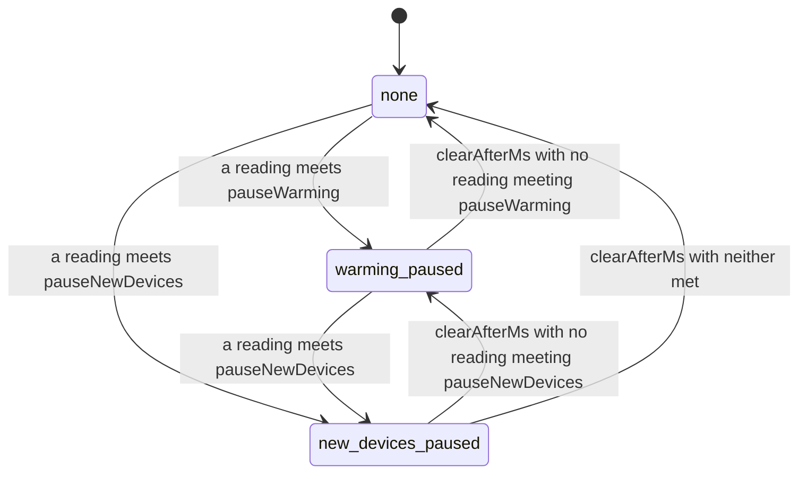
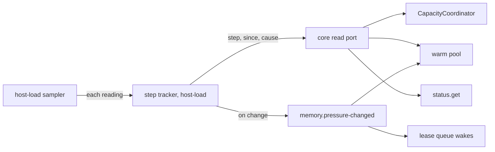

# 0068. A worker pauses warming and new devices under host memory pressure

- **Status:** Accepted
- **Date:** 2026-11-06
- **Issue:** [#1355](https://github.com/callstackincubator/simlock/issues/1355)
  (from request [#1246](https://github.com/callstackincubator/simlock/issues/1246))
- **Supersedes:** nothing. Narrows [ADR
  0029](0029-host-load-is-an-optional-module-whose-readings-ride-on-status.md):
  its Context line "Nothing in Simlock acts on them" no longer holds for
  memory, §1's "Nothing that decides anything reads the readings" gains one
  reader (the step tracker, §2) and the module's tracker reads one config
  section, and §7's "no event per reading" gains one event per step change.
  Adds a rank stage to [ADR 0009](0009-gateway-routing-is-a-list-of-stages.md).

## Context

Workers share their Macs with Xcode builds, local stacks and agents. The
`resource` capacity strategy's RAM budget is total RAM minus 4 GiB, and it
counts only Simlock's own devices. On a 32 GiB Mac whose memory went mostly
to other work, `simlock status` showed `pressure warn` and 14 GiB of swap,
while the budget said 3 of 28 GiB used and the warm pool kept booting
simulators. On a 16 GiB worker every new full simulator hit
`BootTimeoutError` while the queue retried.

The host-load module (ADR 0029) already reads available memory, swap and,
on macOS, the kernel's memory pressure level every 15 s. Nothing acts on
those readings. Three things bind every task of #1355:

- What a reading changes, and when it stops changing it.
- Where the decision is made, given that core may not import host-load
  (`.dependency-cruiser.mjs`, rule `not-host-load`).
- How a gateway learns of it without applying thresholds of its own.

## Decision

### 1. Two steps, each tripped by a level or a floor



A top-level `memoryPressure` config section, beside `diskPressure`:

```json
"memoryPressure": {
  "enabled": true,
  "pauseWarming":    { "level": "warn",     "minAvailablePercent": 20 },
  "pauseNewDevices": { "level": "critical", "minAvailablePercent": 10 },
  "clearAfterMs": 60000
}
```

- A reading **meets** a step when the macOS pressure level is at or above
  the step's `level` (`normal` < `warn` < `critical`; `off` never meets),
  or when available memory is under `minAvailablePercent` of total memory
  (0 never meets). Linux and Windows report no level, so only the floor
  applies there. Under a cgroup limit, total is the limit, as the probe
  already reports it.
- Each step is **on** from the first reading that meets it. It lifts
  `clearAfterMs` after the first reading that no longer meets it, on a
  timer, unless a reading meets it again meanwhile: `critical` at 09:00
  and calm from 09:00:15 lifts at 09:01:15. The worker's step is the
  highest one on. `pauseNewDevices` implies everything `pauseWarming`
  does.
- Each step keeps the time and the reading that turned it on (its
  `since` and `cause`); the worker reports those of its current step. A
  reading that meets a step by its level and its floor both is a `level`
  trigger. At `none` there is neither.
- **No reading is no step.** With `enabled: false`, with host load off,
  with a reading that has no memory part, or with one older than 60 s,
  every step is off at once, without the hold. A broken probe never stops
  a worker.
- It applies under every capacity strategy, `fixed` included: it is about
  the host, not the RAM budget. A gateway ignores the section.

### 2. The daemon tracks the step; core reads it through a port



The step tracker lives in host-load and is fed by the sampler's readings;
it holds the hold timers on the `Clock`. It reads the `memoryPressure`
thresholds through an options type host-load declares for itself, as
`HostLoadSamplerOptions` does, and never imports core (ADR 0029 §1, rule
`host-load-imports-ports-only`). Core owns the config section's type (the
`memoryPressure` slice of its `Config`, ADR 0065 §1); the daemon's worker
composition passes `config.memoryPressure` to the tracker, builds it beside
the sampler and passes core a read port answering the current step. Core
stays clear of host-load. The step is memory only: a restart starts at
none and the first reading sets it.

### 3. The lower step: the warm pool fills nothing and sheds

While `warming-paused` (or higher), the warm pool proposes no boot and no
creation, for targets, learned kinds and queued requests alike; leasing's
own creates and boots go on. On each reading while the step holds, the
pool shuts down at most one idle device (virtual, `ready`, unleased,
unclaimed): devices no configured count keeps first, then configured
targets' devices, least recently used first within each; never a device a
waiting request would be granted. A shut-down device keeps its disk; the
reaper's idle rules delete it later, as today. A target left short reports
`memory-pressure`.

### 4. The higher step: new devices wait

While `new-devices-paused`, `CapacityCoordinator` refuses every
reservation that adds RAM (`tryReserveProvisioning`, `tryReserveBoot`,
`tryReserveRewarm`) with a new refusal reason `memory-pressure`, before
the strategy is asked. Leasing and the warm pool both reserve through it,
so neither creates or boots. A ready device is still granted: it adds no
memory. A plan that reboots a ready device without a reservation (the
`reboot-ready` plan of an `--except` slim lease, #1330) waits too: the
planner asks the same step check before it chooses it. As with `ram-budget`, the refusal evicts nothing; the request
waits with reason `memory-pressure`, and a `noWait` request gets
`NO_CAPACITY` with `capacityReason: "memory-pressure"`. Running leases are
untouched, and a leased device's crash reboot stays outside any
reservation, as today.

### 5. One event per step change

`memory.pressure-changed` `{ from, to, cause? }`, emitted by the step
tracker when the worker's step changes, never per reading. `cause` is the
new step's: `trigger` (`level` or `floor`), `availablePercent` (whole
percent, rounded down, clamped to 0-100), on macOS `level`, and for a
floor trigger `floorPercent`. It is absent when `to` is `none`. On it core wakes leasing's queue and the warm pool runs a pass, so a
lifted step serves waiters at once. While warming is paused, the warm pool
also runs a pass on each reading, through the read port, once it has
started. A gateway lists it among
the events that refresh a worker's view at once, and alert destinations
may list it.

### 6. The worker's verdict rides on status; the gateway reads it

`status.get`'s `capacity` block carries `memoryPressure: { step, since,
cause }` (absent when host load is off; `since` and `cause` absent at
`none`), fitted on the worker before its own output check, as the load
block is. Being in `capacity`, it reaches the
gateway's view of the worker, and a change to it is a change to the view
key a remembered refusal is held against, so the gateway asks the worker
again once it lifts. A gateway reads it from the worker's view and applies no
threshold of its own: it ranks a worker at `new-devices-paused` below one
that is not, in a new rank stage named `memory-pressure`, placed after `free-slot` (so
a warm hit on a paused worker still wins) and before `ram-budget`, and explains it as `full` with `capacityReason:
"memory-pressure"`. The CLI (`simlock status`, `simlock worker list`,
`simlock list --requests`) and the console show it. This is a contract
change and bumps the protocol.

## Consequences

- A worker under pressure stops warming within one reading (15 s) and
  gives memory back one idle device per reading. At `new-devices-paused` it
  also stops adding devices for leases; at `warming-paused`, the default at
  `warn`, leasing's own creates and boots go on (§3).
- Readings now decide something. A pick still never reads raw load: the
  gateway reads the worker's step, which can be up to one refresh old;
  the step-change event refreshes the view at once.
- Pressure that flaps around a threshold holds the step for a minute
  after the last meeting reading, so warming does not start and stop
  every 15 s.
- macOS swap is not an input: it stays high long after pressure ends.
- An upgraded macOS worker that sits at `warn` for hours stops warming
  until the operator raises `pauseWarming.level` or turns it off.

## Alternatives considered

- **Thresholds in `capacity.config`.** Ties a host signal to one strategy;
  `fixed` workers would get none.
- **Swap used as a threshold.** macOS keeps swap used long after pressure
  ends, so admission would stay closed.
- **The gateway applies thresholds to each worker's `load`.** Two places
  to configure, which can disagree, on readings up to 45 s old (ADR 0029).
- **Shed every idle device at once.** Fastest relief, but the whole pool
  is gone after one reading and every next lease pays a full boot.
- **One step.** Leases would stop as soon as warming does.
