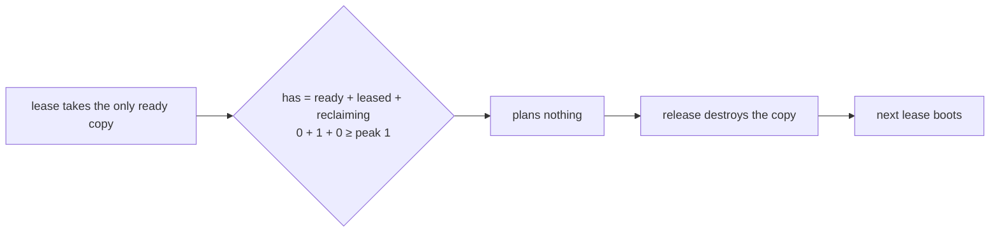
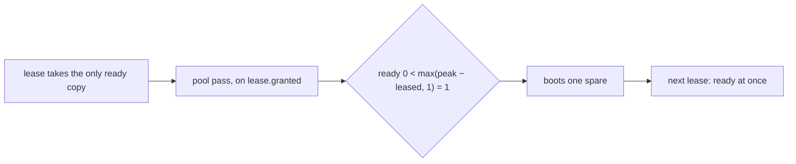

# 0069. A learned kind keeps one ready copy while its copies are leased

- **Status:** Proposed
- **Date:** 2026-11-06
- **Issue:** #1374 (bug #1371)
- **Narrows:** [ADR 0038](0038-the-warm-pool-learns-its-kinds-from-leases-and-boots-for-every-queued-request.md)
  §2 (a learned kind's held devices count toward its peak) and §3's last
  sentence (what a kind both configured and learned needs). ADR 0038 §2's
  count, the peak over 24 hours and at least one, stays. ADR 0062 §1's "Its
  count is ADR 0038 §2's peak, unchanged" stays. A configured target keeps
  ADR 0017 §5: its count is ready devices only.

## Context

ADR 0038 §2 says a learned kind **has** its idle ready devices plus its
leased and reclaiming ones, "so during a burst of three nothing more is
made for a peak of three, and when the three are released they come back
ready for the next burst". ADR 0061 §2 made that premise false: every
virtual device is destroyed after one lease, so a leased copy never comes
back. ADR 0061 narrowed ADR 0038 §5 and left §2 as written.

So a learned kind whose copies are all leased has no ready copy and plans
none. On 2026-11-06 (#1371) a learned baseline of peak 1 had its one warm
copy leased for 7 minutes; no spare booted, and the lease made 2 s after
the release waited 38 s for a boot. The same holds for a plain learned
kind.

## Decision

### 1. A learned kind wants its peak less its leased copies, and at least one ready

For a learned kind of count `L` (ADR 0038 §2's peak, at least one) with `H`
of its devices under an open lease, the pool keeps
`max(L − H, 1)` devices ready, counting the ones on their way as today.
Only a device under an open lease is held: a reclaiming device, or one
under a reclaim claim, is on its way to being destroyed and counts as
neither held nor ready. Since the peak counts every lease held now, `H` is
never above `L`, so the pool keeps between one and `L` ready.

| Peak `L` | Leased `H` | Ready kept, ADR 0038 §2 | Ready kept, this ADR |
| -------- | ---------- | ----------------------- | -------------------- |
| 1        | 0          | 1                       | 1                    |
| 1        | 1          | 0                       | 1                    |
| 3        | 1          | 2                       | 2                    |
| 3        | 3          | 0                       | 1                    |
| 3        | 0          | 3                       | 3                    |

The rule is the same for a plain kind and a baseline kind.

### 2. A kind both configured and learned needs the larger of the two

A kind with a configured count `C` and a learned count `L` is one entry
(ADR 0038 §3). It needs the larger of `C` less its ready devices and
`max(L − H, 1)` less its ready devices. Every configured count still fills
before any learned count, and the budget, displacement and the reaper's
sparing (ADR 0038 §3, ADR 0017 §4 and §5) are unchanged.

## Consequences

- The next lease of a learned kind finds a ready copy while the budget
  allows, also while every other copy of the kind is leased.
- A burst held at its peak costs one more running slot and its RAM per
  kind. Under a full budget the spare is reported short, as any other
  learned shortfall is.
- An agent joining a held burst takes the spare and raises the peak; the
  next pass boots another spare.
- When a burst of `L` ends, the pool boots back up to `L` ready, as today.
- No contract, config key or event changes: `status.get` still reports the
  kind's count as its peak.

## Alternatives considered

- **Keep the full peak ready whatever is leased.** Rejected by the
  maintainer: a burst of three held at its peak keeps six devices running,
  which on a small worker displaces other kinds or hits the RAM budget.
- **Keep ADR 0038 §2 and change the docs only.** Rejected by the
  maintainer: every lease made while all copies are leased pays a boot,
  which is what the warm pool is for.
- **Apply the rule to baseline kinds only.** Rejected by the maintainer:
  a plain kind's copies are destroyed after one lease too, and two rules
  in one planner buy nothing.
