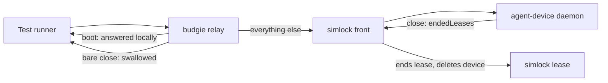
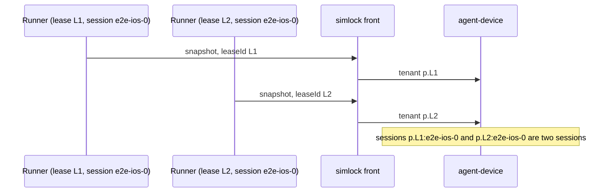

# 0070. Test runners drive a lease through the agent-device front: boot is answered, a close may keep the lease, and each lease is its own tenant

- **Status:** Proposed
- **Date:** 2026-11-07
- **Issue:** [#1419](https://github.com/callstackincubator/simlock/issues/1419) (request [#1292](https://github.com/callstackincubator/simlock/issues/1292))
- **Narrows:** [ADR 0023](0023-agent-device-is-served-by-an-optional-edge-module.md)
  §2 ("one lifetime": a close no longer ends a lease allocated with
  `retainOnClose`; release and the TTL still do) and §4 ("sets agent-device's
  tenant to its principal on every request": a call that names a lease gets
  that lease's own tenant).

## Context

A test runner such as the `e2e` runner (`@e2e-dev/mobile`) drives one leased
device per test worker through the agent-device front. budgie's suite
(budgie-at/budgie#1867) runs it from Linux against a simlock gateway and
puts a local relay in front of simlock to get past four things:

- The runner sends `boot` before it starts and reads `id` and `device` from
  the reply. agent-device refuses it, because simlock's policy file denies
  `boot` (`src/agent-device/shared/daemon-environment.ts:9`).
- The runner closes its session mid-run, and `closeApp` sends `close <app>`.
  Any close ends the agent-device lease, the front sees it in `endedLeases`
  and ends the simlock lease (`src/agent-device/front/ended.ts:43`).
  agent-device has a flag for this, `retainOnClose`, which the runner's own
  provider path sets; the front refuses it (`front/allocate.ts:79`).
- agent-device keeps a session under `<tenant>:<session>`, and the tenant is
  the token's principal (`host/host.ts:126`). Two runs on one token with the
  runner's default session name `e2e-<target>-<slot>` share a session and a
  device.
- simlock's own errors say whether the farm or the device failed only in
  their message text.



## Decision

### 1. The front answers `boot` on the leased device

A `boot` that names a lease the token holds, and no device but that lease's,
is answered by the front from what it knows of the lease. It is never sent to
agent-device:

```json
{ "platform": "ios", "target": "mobile", "device": "<name>", "id": "<udid or serial>", "kind": "simulator", "booted": true }
```

`kind` is `simulator`, `emulator` or `device` (a physical phone). `device`
is the device's name as agent-device reported it at allocate, else the
lease's model. A `boot` naming no lease, or another device, is refused. The
policy file keeps denying `boot` and `shutdown`, so nothing else can boot a
device behind simlock's back.

Why not let agent-device boot the leased device: on a simulator that has
crashed, agent-device runs a plain `simctl boot` and opens Simulator.app, so
a slim simulator comes back full and a headless one gets a window, and
simlock's records never learn of it. simlock owns whether a device runs.

### 2. A lease allocated with `retainOnClose` survives a close

The front accepts `retainOnClose: true` on an allocate and forwards it.
agent-device then keeps the lease on every close, bare or `close <app>`, and
names it in no `endedLeases`, so the simlock lease stays too. Release and
the TTL end both, as before. An allocate without the flag behaves as today:
a close gives the device back.

### 3. Each lease is its own agent-device tenant

Every call that names a lease (allocate, heartbeat, release, a command) is
sent with a tenant made from the principal and the lease id, cut to
agent-device's 128 characters with a hash when longer, the way the gateway
tenant is cut today. A call that names no lease keeps the principal's
tenant. Two leases never share a session, whatever session names their
callers pick.



### 4. simlock's own errors carry a reason and a retriable flag

Every JSON-RPC error the front makes itself carries `details.reason` from a
fixed, documented list and `details.retriable`, as agent-device's own errors
do. The `code` values stay `INVALID_ARGS`, `COMMAND_FAILED` and
`UNAUTHORIZED`, which agent-device's client knows. Errors agent-device makes
pass through unchanged.

## Consequences

- budgie's relay and its error-text matching can go; the runner needs
  `retainOnClose: true` on its allocate and nothing else.
- agent-device's iOS runner prewarm, which its own `boot` starts, does not
  start on a front-answered boot. The `e2e` runner sends
  `prepare ios-runner` right after `boot`, which does the same work.
- `session list` sent without a lease no longer shows sessions of leases.
- A lease's session folders (`<tenant>_<session>`) take the lease's tenant;
  the lease end still finds them, since it reads the tenant from the
  forwarded call.

## Alternatives considered

- **Let agent-device answer `boot`** (drop it from the policy, keep a front
  rule to the leased device): the real reply and prewarm, but a crashed
  device would be cold-booted outside simlock.
- **A new agent-device policy capability that refuses only a cold boot:**
  cleanest, but waits for an agent-device release.
- **A simlock-only keep-on-close flag:** duplicates agent-device's
  `retainOnClose`, and agent-device's own session lease would still end.
- **One tenant per run id:** splits runs, but slots of one run still share by
  session name, and two runs may pick one run id.
- **New error codes:** agent-device's client knows a fixed code set.
