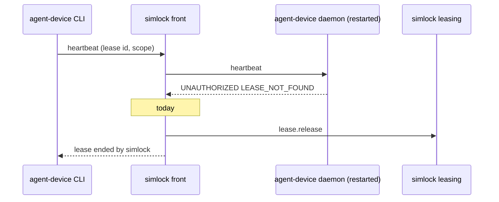
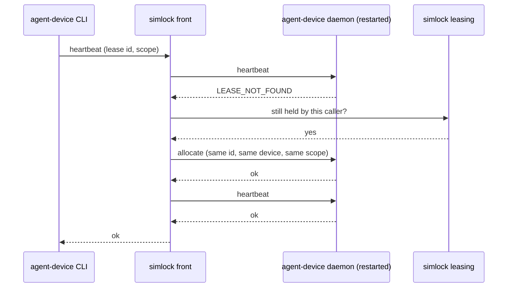

# 0071. A restart re-allocates a live agent-device lease on its device

- **Status:** Accepted — not yet implemented
- **Date:** 2026-11-09
- **Issue:** [#1461](https://github.com/callstackincubator/simlock/issues/1461) (bug [#1103](https://github.com/callstackincubator/simlock/issues/1103))
- **Supersedes in part:** [ADR 0023](0023-agent-device-is-served-by-an-optional-edge-module.md)
  §3 ("A restart loses its agent-device leases; the front answers their
  next heartbeat as ended by simlock and releases the simlock lease") and
  the Consequences line "the leases survive and end on their next
  heartbeat or at their TTL".
- **Narrows:** [ADR 0070](0070-test-runners-drive-a-lease-through-the-agent-device-front.md)
  §2: a lease re-allocated from a rebuilt entry does not carry
  `retainOnClose`.

## Context

agent-device keeps its leases in memory. When its daemon restarts, alone or
with the worker, it forgets them. simlock keeps the simlock lease of a
device that is still running (ADR 0019), so `simlock status` shows the
lease. The agent's next heartbeat gets `UNAUTHORIZED` / `LEASE_NOT_FOUND`
from agent-device, and the front releases the simlock lease
(`src/agent-device/front/heartbeat.ts:154`). The device is wiped, and the
agent is told `lease ended by simlock; run disconnect, then open`.

The agent-device CLI heartbeats before each command and sends its lease
scope with it: `runId`, `clientId`, `leaseProvider`, `leaseBackend` and
`deviceKey` (agent-device v0.21.35,
`src/cli/commands/connection-runtime.ts:892-941`). agent-device accepts an
allocate with a lease id the caller chooses, unless that daemon already
issued the id (`LEASE_ID_IN_USE`,
`packages/daemon/src/resources/lease-registry.ts:81-98`). The issued ids
live in memory, so a restarted daemon accepts it. So the
front has what it needs to allocate the same lease again, as long as it
knows the device.

## Decision

### 1. `LEASE_NOT_FOUND` on a lease simlock still holds re-allocates it

When agent-device answers a heartbeat with `LEASE_NOT_FOUND`, the front
asks simlock whether the caller still holds the lease: leasing's
`lease.list` names it, on a worker or a gateway. If it does, and agent-device did not end the lease itself (`endedLeases`), the
front:

1. sends `agent_device.lease.allocate` with the same lease id, the lease's
   device address, the scope the heartbeat carried, and the `ttlMs` ceiling
   a first allocate gets;
2. sends the heartbeat again and answers with its reply.

The re-allocate keeps the heartbeat's `deviceKey`, which a first allocate
drops: agent-device refuses a later heartbeat whose key the lease lacks.

The agent keeps the same simlock lease, the same device and the same app
data. Its agent-device session does not survive (simlock empties the
daemon's sessions folder at start), so the agent may need `open` again;
`open` works on the same device.
Commands, recordings and session state that the restart interrupted are not
recovered.

Only one re-allocate runs for a lease at a time. A heartbeat that arrives
while one runs waits for it.

### 2. What stays final

- `LEASE_EXPIRED`, `LEASE_REVOKED`, and a lease agent-device ended itself
  (`endedLeases`): as today, the simlock lease is released.
- A lease simlock no longer holds, released or expired: as today, the
  answer is ended by simlock. agent-device reports its own expired lease as
  `LEASE_NOT_FOUND` too. Since simlock's lease is the only clock, the "still
  held" check keeps that case final.
- Nothing revives a lease that has ended.

### 3. A failed re-allocate keeps the simlock lease

If agent-device refuses the allocate (for example `LEASE_ID_IN_USE` on a
daemon that did not restart) or does not answer, the front answers with a retryable error and does not release the
simlock lease. The next heartbeat tries again. While agent-device is
still starting, the heartbeat itself gets `…: starting`, as today, and no
re-allocate is sent. The lease ends only by
release or at its TTL, as any simlock lease does.

On a gateway, a lease the worker's list leaves out for a moment while the
worker starts (the gateway's index still holds it) also gets the
retryable answer, not a release.

### 4. Where the front finds the device

- **agent-device restarted alone:** the front's map still has the entry.
- **Gateway:** the gateway's map has the entry, or rebuilds it from the
  worker's lease list after a gateway restart, as today. A worker restart,
  a gateway restart, or both in either order are covered.
- **Standalone worker restarted:** its map is empty. The worker's front
  rebuilds entries the way the gateway does (`adoptable`): from the
  registry snapshot the module already reads, its leases (one whose
  `requesterId` is its own id and whose `ownerId` is the caller) and their
  devices (address, platform, model, physical). Nothing new is stored.

A phone lease's re-allocate names the phone's serial, so it goes to the
phone daemon as a first allocate does.

## Consequences

- A worker restart, or a crash like #1409, no longer wipes every
  agent-device lease on the worker. Agents see retryable errors for the
  restart (measured by the reporter at about 7 s on Android and 28 s on iOS),
  then `open` again.
- `retainOnClose` (ADR 0070 §2) is in neither leasing's record nor the
  heartbeat. A rebuilt entry (a standalone worker restart, or a gateway
  restart followed by a worker restart) does not carry it,
  so a close after that ends the lease. A worker restart already breaks
  that test run. Tracked as its own issue.
- A lease whose re-allocate keeps failing holds its device until its TTL,
  not until the next heartbeat.
- The edge tests that pin today's release after a restart change.

## Alternatives considered

- **Persist leases inside agent-device.** It removes the second allocate,
  but it changes another tool. Rejected by the maintainer.
- **Save front entries in `state.db`.** It keeps `retainOnClose`, but it
  adds a table and a migration, and it copies facts leasing already holds.
  Rejected: rebuilding from leasing covers every other field.
- **Re-allocate on every command, not only the heartbeat.** The CLI sends a
  heartbeat before each command anyway, so this only adds paths.
- **Also re-allocate on `LEASE_EXPIRED` and `LEASE_REVOKED`.** Rejected:
  those are ends a person or the clock chose.
