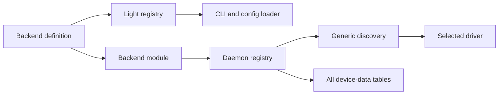

# 0072. Backends register their definition, factory and device data

- **Status:** Proposed
- **Date:** 2026-11-10
- **Context:** [ADC prototype #1471](https://github.com/callstackincubator/simlock/pull/1471) and its [architecture feedback](https://github.com/callstackincubator/simlock/pull/1471#issuecomment-6770222478)
- **Extends:** [ADR 0065](0065-a-driver-owns-its-config-keys-and-a-module-takes-the-sections-it-reads.md)
- **Narrows:** ADR 0061's assumption that every virtual backend supplies saved sources; a backend declares whether it supports baselines.

## Context

The ADC prototype works through the existing agent and gateway surfaces, but
adding it changes discovery, prerequisite selection, state loading and device
lifecycle code. Another provider would need to edit those places again.

State loading currently selects one data table per platform. Selecting a
different Android implementation can make the previous implementation's rows
unreadable. A device's owner must remain the implementation that created it.

## Decision

### Definitions and modules have separate registries

`BackendDefinition` is light data: an id, platform, configuration defaults and
validators, and capabilities. The CLI and config loader use the light registry.
They import no driver implementation. Settings for `drivers.<platform>.*` and
runtime settings under the platform section are selected by the backend.

`BackendModule` supplies the definition, a device-data table, prerequisites and
the driver factory. The daemon's heavy registry imports these modules. Discovery
selects a module by platform and configured backend id, builds its context once,
then runs the same prerequisite/factory flow for every implementation. Unknown
backend ids are configuration errors.

Local Android and iOS use the explicit id `local`. Omitting the backend setting
selects that definition. One backend per platform is active on a worker.
Selecting a different backend requires a restart and does not migrate devices
between providers.

### Device records retain their backend

Each device record stores its backend id. Existing published records migrate to
`local`. Device-data readers are keyed by both platform and backend; every
registered backend's table is opened even when that backend is not selected.

A device whose backend is unavailable remains readable and visible. Device
operations, observations, cleanup and acquisition check the recorded backend
before dispatching to a driver. They never reinterpret it using the currently
selected implementation. Old backend devices remain owned resources and are
not silently forgotten.

Startup tunnel cleanup receives only the selected backend's devices.

The backend field is carried by device grants and views, so the daemon protocol
version advances with this change. Existing operator configuration keys keep
their meaning; `drivers.<platform>.backend` defaults to `local`.

### Implementation sequence

The registry extraction registers local Android and iOS without changing device
records or the daemon protocol. This step adds recorded device ownership and
its wire migration. Capabilities remain metadata.

Before another backend is registered, a follow-up must preserve saved-baseline
and source ownership and enforce capabilities at common admission paths. That
change needs its own state migration and tests; source ownership and capability
admission are not implemented by the device ownership step.

This decision adds no provider deadline or renewal mechanism. Simlock's
TTL-first agent lease remains governed by ADR 0004. A backend that needs an
additional lifetime contract requires a separate decision.

## Consequences

- A backend adds its own folder, a light registry entry and a heavy registry
  entry. Public settings and behavior are documented with that backend.
- A backend's heavy entry is its component's `index.ts`. Backend subcomponents
  under a platform driver have their own import boundary; the platform driver
  does not own their private files. Other module boundaries keep their existing
  entry points. Definitions remain separate light entry points.
- Shared backend context carries ports, host facts, capture artifacts, logging
  and diagnostic callbacks. Drivers do not depend on the daemon or event bus.
- USB devices remain tied to the selected backend in this version. Supporting
  local phones alongside another virtual backend requires explicit routing.
- The unpublished ADC prototype uses a separate data directory. Its old records
  are not part of the published registry migration.
