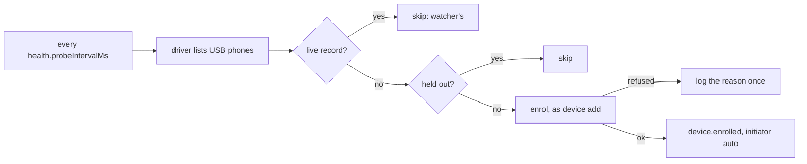

# 0073. A worker may enrol the phones plugged into it

- **Status:** Proposed
- **Date:** 2026-11-10
- **Issue:** [#1503](https://github.com/callstackincubator/simlock/issues/1503) (request [#1502](https://github.com/callstackincubator/simlock/issues/1502))
- **Narrows:** [ADR 0022](0022-a-physical-device-is-a-second-device-type-the-core-knows.md)
  §3 ("a registry record an admin created with `device add` … Nothing
  else: not a name, not being plugged in", and "never runs a command on a
  device with no record"), §5 ("a device that is not enrolled gets no
  entry and no command") and §6 (`device add` is the only way a record is
  made).

## Context

An admin enrols every phone by hand: `simlock device add --platform
ios|android <id>` on the worker the phone is plugged into. A host with a
phone rack or a USB hub, where phones come and go, needs someone at the
worker each time. A plugged-in phone nobody enrolled is not in the pool,
and requests for it wait or fail `NO_CAPACITY`.

What a worker already does:

- The physical-device watcher reads every enrolled phone every
  `health.probeIntervalMs` (default 30 s).
- Both drivers read the host's whole device list and then drop the phones
  that are not enrolled. Android runs `adb devices -l` on the default adb
  server. iOS runs `devicectl list devices`.
- `device add` inspects one ID: it needs USB and a trusted phone with
  Developer Mode on, an unlocked iPhone, and iOS 17 or later. It then
  records the model, OS, class and the apps installed now (the kept apps)
  and writes the record `ready`.

ADR 0022 makes the admin's `device add` the only proof that a phone is
Simlock's. This ADR adds a second proof, which the admin turns on for the
whole worker.

## Decision

### 1. `devices.autoEnroll` is an admin's standing consent

A worker key, `devices.autoEnroll` (boolean, default `false`). Off, nothing
changes from today. On, a phone connected to the worker by USB is enrolled
as `device add` would enrol it. Turning the key on is the admin's consent
for every phone plugged in from then on. The key covers both platforms. It
is read at start, like every other config key. A gateway has no drivers and
never reads it.

Ownership of a physical device stays its enrollment record (ADR 0022 §3).
Only how a record may be made widens: an admin's `device add`, or the
worker under `devices.autoEnroll`.

### 2. The worker looks for new phones on the watcher's interval

A driver gains one host-level read: list the canonical IDs of the phones
on USB, in any state. Android: every `adb devices -l` entry with a `usb:`
transport, on the default server behind its protocol check (ADR 0022 §5).
iOS: every `devicectl list devices` entry with transport `wired`. A phone
reached only over the network is not listed. The read names no phone and
sends nothing to one.

Each tick, for each listed ID with no live record (a record not `deleted`)
that is not held out (§3), the worker runs `device add`'s own enrolment.
That runs the same checks and refusals, the same canonical-ID rule and the
same kept-apps read, and it holds the same claim. It never re-enrols. An ID
that already has a record when the enrolment commits is left as it is, so
an admin's `device add` in the same moment wins and the kept apps are not
read twice.

A phone that cannot be enrolled yet (locked, not trusted, Developer Mode
off, iOS below 17, an Apple TV) is tried again on every tick. Its reason is
logged once each time it changes, with no event. Nothing else shows it.

Polling, not notifications. `adb track-devices` would keep one connection
open to the default server, which does not fit the protocol check made
before every physical command. iOS has no public notification. A phone is
enrolled within one interval of being plugged in, which is soon enough for
a rack.

### 3. A removed phone stays out until it is plugged in again

When a phone's record goes away while the phone stays plugged in, the
worker holds it out: through `device remove`, or when it is unenrolled
after its quarantine retries ran out. The worker remembers, in memory, each
listed ID it has seen with a live record. Such an ID with no live record is
held out. An ID missing from the USB list for `health.stableObservations`
ticks in a row is forgotten, so plugging it in again enrols it. `device add`
enrols a held-out phone as always.

The memory dies with the daemon. After a restart, a removed phone that is
still plugged in is enrolled again on the first tick. An admin who wants a
phone out for good unplugs it, or turns `devices.autoEnroll` off.

### 4. Events

`device.enrolled` gains `initiator`: `"operator"` for `device add`,
`"auto"` for this path. `device.deleted` already carries one. The change is
additive.

### 5. Safety

Safety rule 1 ("never runs a command on one that is not enrolled"), rule 7
("read only for enrolled IDs") and rule 8 ("because an admin enrolled
it") gain one exception each, under `devices.autoEnroll` only:

- the host-level USB list is read whole;
- `device add`'s inspection runs on a listed phone with no record. It is
  reads only: properties, lock state and the installed-app list.

Nothing destructive ever runs on a phone with no record. The first
uninstall happens at its first reclaim, and that keeps the apps found at
enrolment.

## Consequences

- A personal phone plugged into a worker to charge is enrolled and leased
  to agents, and agents may install and run apps on it. The docs say so
  next to the key. This is the cost of a consent given once for all phones.
- The apps on a phone at plug-in time become its kept apps. An app an agent
  left behind when its cleanup failed is kept too, if the phone was dropped
  and then plugged in again.
- After a restart, a removed phone that is still plugged in comes back.
- No new state on disk. No contract operation and no error code. The config
  shape gains one key, so the protocol is bumped once.
- Each tick costs one list per platform. Inspections run only for phones
  with no record, so the cost of a pool of enrolled phones is unchanged.
