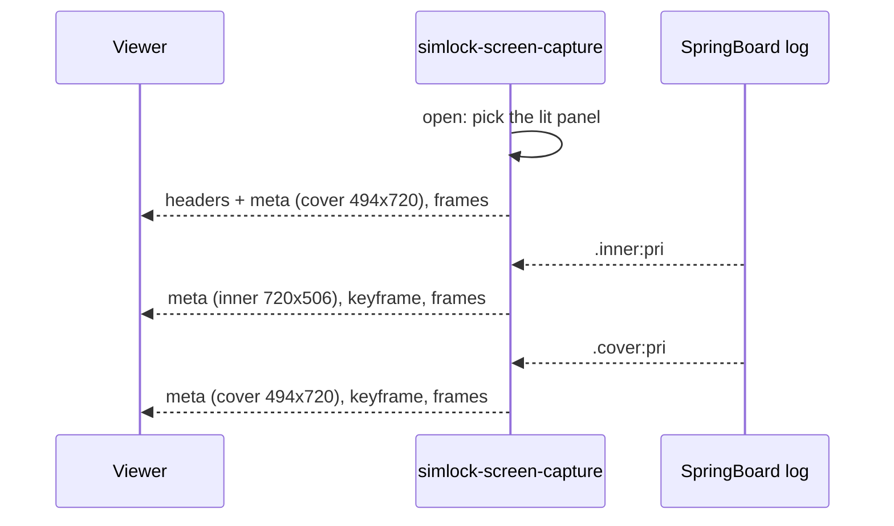

# 0075. A foldable simulator streams the panel in use, and a stream may change size while it runs

- **Status:** Accepted — not yet implemented
- **Date:** 2026-11-11
- **Issue:** [#1531](https://github.com/callstackincubator/simlock/issues/1531), bug [#1457](https://github.com/callstackincubator/simlock/issues/1457)
- **Narrows:** [ADR 0031](0031-a-physical-iphone-streams-through-coredevice-behind-a-screen-source-seam.md)'s
  Consequences line "the stream module, the frame envelope, the HTTP API
  and the console do not change", for the size of the picture; and
  [ADR 0052](0052-an-ios-simulator-takes-serve-sims-rotation.md) §4's
  "positions stay fractions of the device's native frame", for a
  two-panel device (§4 below).
- **Evidence:** draft PR [#1525](https://github.com/callstackincubator/simlock/pull/1525),
  a proof of concept on an iPhone Duo (iOS 27.2, Xcode 27.2).

Shapes, limits and messages live in the feature's design tables (#1531);
this record holds the decisions and why.

## Context

An iPhone Duo simulator has two touch panels: a cover (1398×2034,
upright) and an inner panel (2007×2853, mounted at 270°, so its raw
framebuffer holds the picture on its side). Both framebuffers stay live in
every pose; the panel not in use is painted black.

`simlock-screen-capture` attaches to the cover, so an unfolded Duo streams
black. Its scaler is sized once and its meta frame is written once, so a
picture that changes size mid-stream is squeezed into the first one's
scale. The stream's `simlock-stream-width` and `-height` headers describe
that one size for the whole stream.

On iOS 27.2 no simulator callback fires on a fold: no surfaces- or
properties-changed call, and the host-side backlight values never change.
SpringBoard's `DisplayContentMode` log names the panel in use about a
second after each fold. Its text is not documented by Apple.

## Decision

### 1. The capture streams the panel in use

At open it picks the panel that is lit. While it runs it follows
SpringBoard's `DisplayContentMode` log and switches on each settled move.
A panel mounted on its side is turned upright before encoding. A device
with one panel starts none of this.

### 2. The log is a hint, never a requirement

A stream whose log line never comes stays on the panel it picked at open
and logs one line. A fold that the log does not report is not followed. The
stream never fails because of the log.

### 3. A stream may change size while it runs

When the picture's size changes, the capture rebuilds its scaler, writes a
new meta frame with the new size, and starts the new size on a keyframe
with fresh parameter sets. The size headers describe the picture when the
stream opens; each later meta frame gives the size from then on. This
holds for every source, so a physical iPhone that rotates mid-stream is
rescaled too.

### 4. Taps follow the same panel

The input helper uses the same panel follower as the capture, because it
cannot read from the host which panel is lit. A tap's fraction is of the
picture the viewer sees. On a two-panel device it goes to that panel's
own digitizer target, and the inner panel's fraction is turned back to
its sideways framebuffer. The helper sends a new screen config, with the
upright size of the panel in use, on each change; a one-panel device
keeps today's target and config. `0x82` still says `portrait` on both
panels, as 0052 §4 has it; only the meaning of a fraction changes, from
the device's native frame to the upright picture the viewer sees. Measured on an iOS 27.1 Duo: today's
target misses the cover, and lands turned a quarter on the inner panel.

### 5. The helpers' children die with them

Every process the capture or the input helper starts to follow the log
ends when that helper ends, by any way out, SIGKILL included.

## Consequences

- A third-party viewer that reads the size once draws a stretched picture
  after a fold until it reconnects. The HTTP reference and the website say
  a meta frame may come again.
- Following a fold depends on SpringBoard's log text. A release that
  changes it leaves the stream on the panel picked at open until the
  parser is updated.
- A physical iPhone's rotation changes the stream's size; nobody has run
  it on hardware.

## Alternatives considered

- **Letterbox both panels into the size at open.** Keeps the headers true
  for the whole stream, so no viewer breaks. Rejected: a smaller picture
  with black bars in one pose on every viewer, to protect viewers that do
  not exist yet.
- **Log only, as the proof of concept.** Rejected: a stream opened
  unfolded shows the cover's black for 2–4 s (once over 8 s) while the
  boot's log is read.
- **Brightness only, no log.** No undocumented dependency, but the capture
  would have to keep sampling the other panel to notice a fold. Untried,
  and more work per stream.
- **Taps unchanged, a known gap.** Rejected by the maintainer: a picture
  that cannot be tapped where it is seen is half the feature.
- **End the stream on a fold, and let viewers reconnect.** Keeps the
  contract. Rejected by the maintainer: the switch should not drop the
  viewer.
