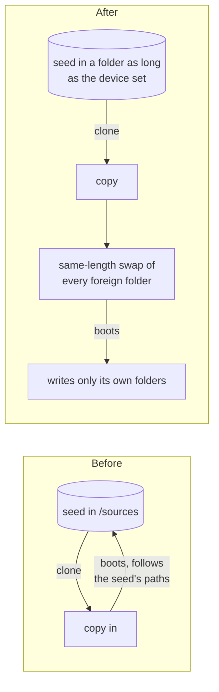

# 0076. An iOS clone names only its own folders before its first boot

- **Status:** Proposed
- **Date:** 2026-11-15
- **Issue:** [#1561](https://github.com/callstackincubator/simlock/issues/1561), bug [#1548](https://github.com/callstackincubator/simlock/issues/1548)
- **Narrows:** [ADR 0061](0061-every-virtual-device-is-a-copy-of-a-source-and-a-baseline-is-a-named-source.md)
  §1's iOS sources locations (`<device root>/sources`,
  `$SIMLOCK_HOME/devices/ios-sources`) and §2's iOS Copy row (one more
  step before a clone's first boot, beside the LaunchServices database
  drop). Sources still live in their own set, apart from the copies.

Shapes, limits and messages live in the feature's design tables (#1561);
this record holds the decision and why.

## Context

A simulator that has booted stores absolute paths to its own device
folder (`<set>/<udid>`) and its log folder
(`~/Library/Logs/CoreSimulator/<udid>`): in symbolic links, plists and
other files. `simctl clone` copies those bytes, and today a clone changes
only its LaunchServices database before its first boot. A booted copy
then follows its seed's paths and writes into the seed.

Measured 2026-11-15 on Xcode 27.2, iPhone 17, in throwaway sets laid out
as Simlock's (`devices/`, `devices/sources/`):

- A seed booted once names its own UDID in one link (`data/Library/Logs`
  → the seed's log folder), in binary plists (ManagedSettings records,
  Safari's preferences) and in two unified-log `.tracev3` files. The same
  folder is spelled both `/private/tmp/…` and `/tmp/…`.
- Today's flow (iOS 27.2): within 90 s of its boot a copy wrote two files
  into the seed (`data/Library/com.apple.ManagedSettings/Records/…/tokenized.plist`),
  and its `Logs` link pointed at the seed's log folder.
- Today's flow (iOS 27.0, a copy used: Safari, a reboot, 90 s idle): 5
  files written into the seed. A copy of a baseline saved from a used copy
  wrote 204 files into that used copy's folder (home-screen snapshots,
  the Photos library).
- A rewrite that parses each format (links, plists with their keys, JSON
  with `\/` separators, text) left paths in SQLite rows, Spotlight
  indexes, caches and widget timelines: a seed's copy still wrote 9 files
  into the seed (a download path kept in `nsurlsessiond/tasks.sqlite`), and
  one of two baseline copies wrote a home-screen snapshot into the used
  copy. Deleting what it could not rewrite did not stop the snapshot.
- With the sources set at a path exactly as long as the device set's, a
  byte-for-byte swap of every foreign folder's path, in every file and
  link, after flushing every SQLite WAL in the source: four copies (two of
  a seed, two of a baseline saved from a used copy), each used as above,
  wrote nothing into any other simulator's folder. 216 swapped SQLite files
  passed `integrity_check`. Only `.tracev3` log history still named other
  simulators. Reading every byte took 1.6 s for a seed's copy and 13–17 s
  for a 2.4 GB baseline's.

Sources live in their own set (ADR 0061 §1) so that no lease holder's
`simctl` lists them, so a seed's folder and its copy's differ by more than
the UDID: a same-length UDID swap cannot work.

## Decision

### 1. Sources live at a path as long as the device set's

Under both settings the sources set is
`realpath($SIMLOCK_HOME)/devices/src`, followed by `_` until its real path
is exactly as long as the real path of the set the copies live in (the
owned root under `simlock`, Xcode's `Devices` under `default`). It is an
owned root under both. Both folders are under `/private`, or neither,
because iOS writes a folder under `/private` in two spellings (`/tmp/…`
and `/private/tmp/…`) and only one of them could match. When the name
would be shorter than `src`, or only one folder is under `/private`, iOS
does not start (`driver.root-rejected`, reason `sources-path-unfit`) and
the message says how to fix `SIMLOCK_HOME`. The copies do not move.

### 2. A source is flushed and indexed when it is made

When a seed is made, and when a baseline is saved, after the clean
shutdown and before the row turns `ready`: every SQLite WAL in it is
flushed into its database (`wal_checkpoint(TRUNCATE)`), because a WAL
frame carries a checksum a swap would break; then every file and link
that names any device folder or log folder, the source's own included, is
found once and recorded with the source, and the source is marked as
indexed. A WAL that cannot be flushed is logged and never patched.

### 3. Every lease's copy swaps foreign folders for its own before its first boot

In each recorded link target and file of a new copy, every
`<device set or sources set>/<UDID>` and `~/Library/Logs/CoreSimulator/<UDID>`
whose UDID is not the copy's own becomes the copy's own, byte for byte, in
each spelling and with `/` or `\/` separators. A file's length never
changes, so the swap needs to understand no format. It runs beside the
LaunchServices drop of ADR 0061 §2, and a copy whose swap fails is
deleted, as one whose drop fails is.

### 4. Sources made before this are not copied as they are

A seed whose row names another set, or has no record of §2, is destroyed
and made again by the existing stale-seed path. A baseline whose row names
another set is stale (`saved in <set>, which copies cannot be fixed from;
save it again`) and answers `BASELINE_STALE` from the first request after
the worker starts, since core now checks baselines for staleness at
startup; it is deleted in its own set when removed.

Shapes, messages and the table live in #1561's design tables.

## Consequences

- A lease's simulator writes only into its own folders; seeds and
  baselines stop growing, and leases of one kind stop sharing state.
- The first lease of each kind after the upgrade makes its seed again
  (about 40 s once). Every baseline saved before must be saved again.
- `deviceSet: "default"` needs a `SIMLOCK_HOME` outside `/tmp` and `/var`
  and short enough for the padding; the slow lane's homes move out of
  `/tmp`.
- Making a source reads it once in full; each copy patches only the
  recorded files.
- A file format that compresses or checksums a path (the `.tracev3` log
  history today) keeps the old path; such a file is never followed as a
  path today.

## Alternatives considered

- **Make seeds beside the copies, then swap UDIDs byte for byte.** Under
  `deviceSet: "default"` the seed would sit in Xcode's own set, listed by
  Xcode, DeviceHub and every `simctl list`, and hit by "Delete All
  Simulators" (ADR 0048). Rejected for a separate folder of the same
  length.
- **Make the seed read-only.** A copy that follows a path into the seed
  then fails to write its own state. Rejected.
- **Rewrite each format in the copy, the sources staying where they are.**
  Measured: paths remained in SQLite rows, indexes and caches, and copies
  still wrote into the seed and into a baseline's used copy. Every format
  needs its own parser, and each iOS release may add one. Rejected.
- **Rewrite one seed→copy pair.** A baseline saved from a copy names two
  other simulators (the seed and the copy it was saved from). Rejected for
  matching every foreign UDID.
- **Sources beside Xcode's set under `default`**
  (`~/Library/Developer/CoreSimulator/<tag>`), always the right length and
  never under `/private`. Rejected by the maintainer: everything Simlock
  keeps stays in `SIMLOCK_HOME`, at the cost of refusing an unfit home.
- **Move the copies under `simlock` (`<root>/d` beside `<root>/s`).** Ends
  leases running at the upgrade and needs `simctl` at startup to clear the
  old set. Rejected for moving only the sources.
- **Migrate old baselines with a format rewrite.** Keeps the measured
  leak for them. Rejected for "save it again".
- **Scan the whole copy each time.** 13–17 s for a 2.4 GB baseline.
  Rejected for recording the files once per source.
