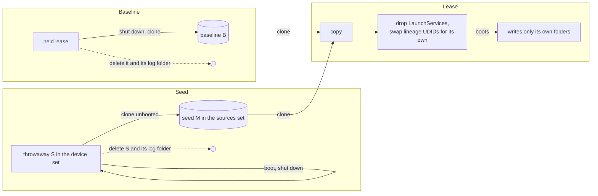

# 0076. An iOS clone names only its own folders before its first boot

- **Status:** Accepted — not yet implemented
- **Date:** 2026-11-15, revised 2026-11-16
- **Issue:** [#1561](https://github.com/callstackincubator/simlock/issues/1561), bug [#1548](https://github.com/callstackincubator/simlock/issues/1548)
- **Narrows:** [ADR 0061](0061-every-virtual-device-is-a-copy-of-a-source-and-a-baseline-is-a-named-source.md)
  §1's seed ("create, one cold boot to ready, clean shutdown": the boot
  now happens in a throwaway device, never in the source), §2's iOS Copy
  row (one more step before a clone's first boot, beside the LaunchServices
  database drop) and §4's iOS save (the leased device's log folder is
  deleted with it). It narrows §3 too: a source is also stale when it has
  no lineage record (§4 below), beside the runtime or image gone or
  changed. And §1's definition of a source ("has booted at least once")
  no longer holds for an iOS source: it never boots, only its throwaway
  does. Sources still live in their own set, apart from the
  copies.

Shapes, limits and messages live in the feature's design tables (#1561);
this record holds the decision and why.

## Context

A simulator that has booted stores absolute paths to its own device
folder (`<set>/<udid>`) and its log folder
(`~/Library/Logs/CoreSimulator/<udid>`): in symbolic links, plists, SQLite
rows, Spotlight indexes, caches and widget timelines, sometimes in UTF-16.
`simctl clone` copies those bytes, and today a clone changes only its
LaunchServices database before its first boot. A booted copy then follows
its seed's paths and writes into the seed.

Measured 2026-11-15 on Xcode 27.2, iPhone 17, in throwaway sets laid out
as Simlock's (`devices/`, `devices/sources/`):

- Today's flow: within 90 s of its boot a copy wrote files into the seed
  (ManagedSettings records), and its `Logs` link pointed at the seed's log
  folder. A copy of a baseline saved from a used copy wrote 204 files into
  that used copy's folder (home-screen snapshots, the Photos library).
- A rewrite that parses each format left paths behind, and copies still
  wrote into the seed.
- A byte-for-byte swap of foreign folder paths, with the sources set
  padded to the device set's length, stopped the writes, but its search
  for paths cannot be shown complete (UTF-16 and compressed paths were
  missed at first; files over 64 MiB were skipped), and the padding
  refuses some `SIMLOCK_HOME`s.

Measured 2026-11-16 ("copy then remove", Xcode 27.2, throwaway sets; one
lineage on iOS 27.1 / iPhone Duo, then two per arm on iOS 27.2 / iPhone 17,
with and without the swap: a throwaway
S booted and used, cloned unbooted as the seed M; a lease L0 of M, used,
saved as the baseline B; two leases L1 and L2 of B booted together, each
changed, rebooted once and left idle 30 minutes; a control simulator
booted throughout):

- A source that never boots is never named by any file. M and B were
  byte-for-byte unchanged in every run, with or without a swap.
- Every foreign path a lease inherits is then `<device set>/<UDID>` or
  `~/Library/Logs/CoreSimulator/<UDID>` of a simulator in its lineage (S,
  L0): it differs from the lease's own path only by the UDID.
- With the LaunchServices drop alone, user-visible state survived, but
  each L1 named S in 20–25 files and L0 in 32–34 (Spotlight, FrontBoard,
  CloudKit, Biome, PosterBoard, assetsd, Screen Time, the app's own
  defaults). Screen Time records recreated S's and L0's deleted folders,
  and L1 and L2 wrote the same paths there. A defaults value holding an
  absolute path pointed into deleted L0. During each L1's run, 101 and 222
  log lines named a foreign UDID, mostly failures (Photos analysis,
  assetsd, Siri and Shortcuts databases, chronod, SpringBoard posters).
  Only 11 small files reappeared against 50+ files naming a foreign UDID,
  so a reappearing folder is a weak sign of a miss.
- With the WAL flush and the UDID swap of §2–3: no folder reappeared, the
  defaults path named the lease's own container, an independent scan
  (any UUID-shaped text, dashed or not, any case, UTF-16LE and BE, plus the
  lineage's raw 16-byte, base64 and hex forms, inside plists, compressed
  data, SQLite dumps and blobs, extended attributes and link targets)
  found no foreign UDID, and no log line named one. Swapping took
  6.5–19.7 s over 1.8–2.2 GB, reading every byte. The flush covered
  329–368 databases with no failure and left every `-wal` file empty.
  1–2 locationd caches could not be read by the host user.
- In both arms crashes matched the control's kinds, and every SQLite
  database passed `integrity_check` except two that use a tokenizer the
  host's `sqlite3` lacks.

Other tools clone the same way and live with it, because their clones last
one test run. Xcode's parallel testing (Xcode 27.2, two workers) cloned a
booted device into `XCTestDevices` and rewrote nothing; each clone named
the source in 44–45 files, and while the source was shut down its folder
gained 56 files and changed 19 (the Photos library and its WAL, widget
timelines, Screen Time records), written by both clones. Bluepill clones a
booted template with `cloneDeviceAsync` and changes nothing either.

## Decision

### 1. A source never boots, and the simulator it was copied from is deleted

A seed is made by creating a throwaway simulator in the device set the
copies live in, booting it to ready and shutting it down cleanly, then
cloning it, unbooted, into the sources set as the seed; the throwaway and
its log folder are deleted. The throwaway is in neither the registry nor
the sources set (under `deviceSet: "default"` it sits in Xcode's own set),
so the source's `making` row stores its UDID as soon as `simctl create`
returns it, the throwaway is deleted only through that row, and a restart
mid-make deletes it ([ADR 0001](0001-simlock-owned-device-roots.md) §6). This is one case beside
sources in [safety rule 1](../agent-rules/safety.md). A baseline is saved as ADR 0061 §4 says, and
the leased device's log folder (`simctl delete` leaves it) is deleted with
the device. A source therefore never names itself, and every path it
carries names a deleted simulator of the same device set. The sources set
may be at any path; its length does not matter.

### 2. A source is flushed and records its lineage when it is made

After the clean shutdown and before the row turns `ready`, every SQLite
WAL in the source is flushed into its database (`wal_checkpoint(TRUNCATE)`),
because a WAL frame carries a checksum a swap would break. The source
records its **lineage**: the UDIDs of the simulators it was copied from
that have booted (a seed: its throwaway; a baseline: its device's UDID and
its own source's lineage) and the files and links that name any of them,
found by reading every byte once with no size limit. A lease's device
keeps its source's lineage, so a save knows it without reading the copy.
The device set is not recorded: switching `deviceSet` is refused while any
source is left (ADR 0048). A file the host cannot read is recorded as unreadable. A WAL that
still holds frames after the flush is logged and never patched.

### 3. Every lease's copy swaps its lineage's UDIDs for its own before its first boot

In each recorded file and link target of a new copy, every lineage UDID
becomes the copy's own, byte for byte: upper and lower case ASCII, and
UTF-16LE and UTF-16BE. A UDID has one length, so the swap understands no
format, and the spellings of a folder (`/tmp/…` and `/private/tmp/…`) are
covered because only the UDID changes. A `-wal` file is never patched. An
unreadable file is left as it is and logged. The swap runs beside the
LaunchServices drop of ADR 0061 §2, and a copy whose swap fails is deleted,
as one whose drop fails is.

### 4. Sources made before this are not copied as they are

A source with no lineage record is stale: a seed is deleted and made
again, and a baseline answers `BASELINE_STALE` from the first request
after the worker starts, since core now checks baselines for staleness at
startup. A baseline saved from a device made before this has no lineage
either. The reason's wording lives in #1561's design tables.

## Consequences

- A lease's simulator writes only into its own folders: seeds and
  baselines stop growing, and leases of one kind stop sharing state, as
  they do in Xcode's own parallel testing.
- Absolute paths an app stored before a baseline was saved resolve to the
  lease's own container.
- No `SIMLOCK_HOME` is refused for its length or for being under `/tmp`;
  the sources set needs no padding.
- Making a seed shows a throwaway `simlock-` simulator in the device set
  for about 40 s, in Xcode's own set under `deviceSet: "default"`.
- Making a source reads it once in full (6.5–19.7 s for 2 GB measured as a
  whole-copy swap); each copy patches only the recorded files.
- The first lease of each kind after the upgrade makes its seed again.
  Every baseline saved before must be saved again.
- An unreadable file (1–2 locationd caches measured) and a format that
  hides a UDID other than as ASCII or UTF-16 keep the old UDID. The
  independent scan found none after the swap.
- In one of two lineages, a baseline's copy added a second Photos entry
  for a photo the seed already had once its paths were its own (cause not
  confirmed).

## Alternatives considered

- **No swap: copy then remove with the LaunchServices drop alone.** Seeds
  and baselines stay clean, and Xcode's parallel testing works this way.
  Measured: leases share Screen Time state through recreated folders,
  stored absolute paths name deleted folders, and daemons keep failing
  against them. Rejected for leases that last longer than a test run.
- **Keep the simulator a source was copied from, so its paths resolve.**
  Measured: copies write into it (two leases into the same files), as
  Xcode's clones write into their source. Rejected.
- **Pad the sources set to the device set's length and swap whole folder
  paths** (this record's first version). The search for paths could not
  be shown complete, files over 64 MiB were skipped, and an unfit
  `SIMLOCK_HOME` was refused. Rejected for never booting a source, which
  leaves only UDIDs to swap.
- **Rewrite each format in the copy.** Measured: paths remained in SQLite
  rows, indexes and caches. Every format needs its own parser. Rejected.
- **Make the seed read-only.** A copy that follows a path into it fails
  to write its own state. Rejected.
- **Detect misses by a deleted folder reappearing.** Measured: 11 files
  reappeared against 50+ naming a foreign UDID. Rejected as a check.
- **Swap in the whole copy each time, with no record.** 6.5–19.7 s per
  lease for 2 GB. Rejected for recording the files once per source.
