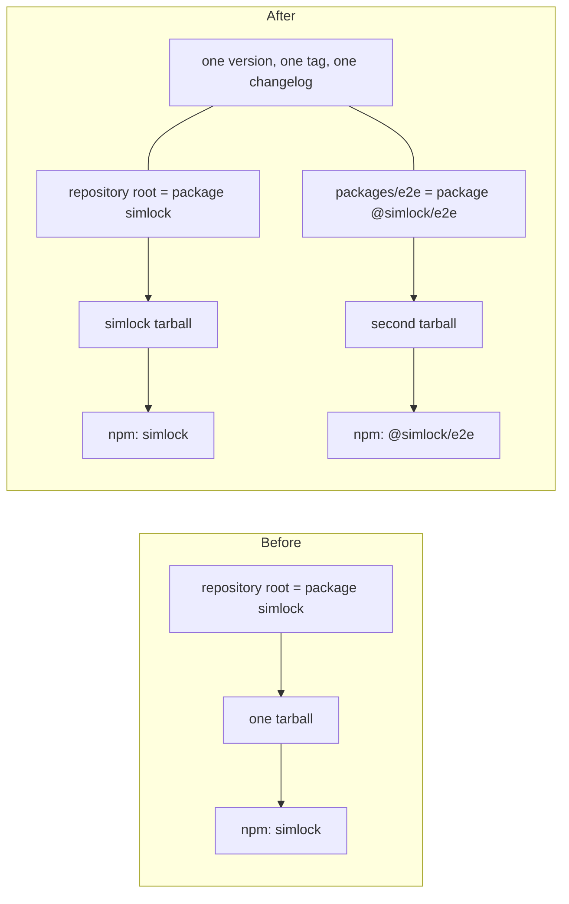
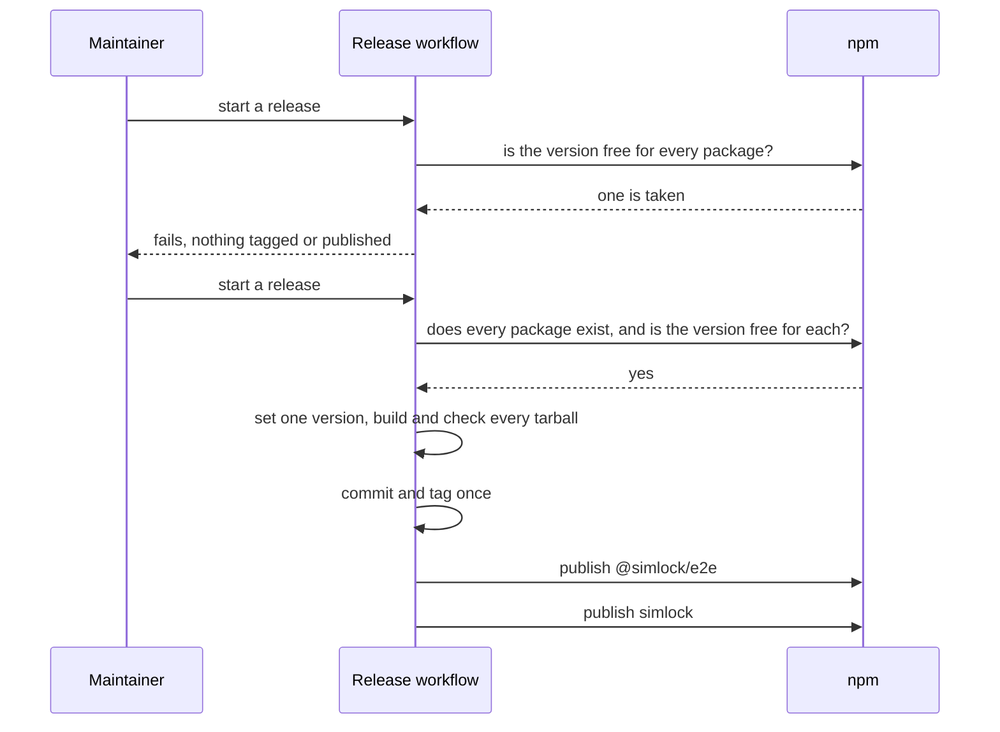

# 0077. The repository is a workspace, and its packages release together under one version

- **Status:** Accepted — not yet implemented
- **Date:** 2026-11-15
- **Issue:** [#1562](https://github.com/callstackincubator/simlock/issues/1562) (request [#1298](https://github.com/callstackincubator/simlock/issues/1298))

## Context

simlock is one npm package. `src/` sits at the repository root, one
`package.json` describes it, and the release workflow packs and publishes one
tarball. Everything a user imports is an entry of that package
(`simlock/client`, `simlock/admin`).

Feature #1562 adds a device provider for the `e2e` test runner. It runs on a
CI machine, often Linux, that never runs a daemon. As an entry of `simlock`
it would make every CI job install the daemon, the console and two Swift
programs to get a few hundred lines. It also needs two libraries the daemon
does not (`@e2e-dev/mobile`, `agent-device`), as peer dependencies.

More small packages of this kind are likely: a provider for another runner,
a remote client.

## Decision

### 1. The repository is a pnpm workspace; `simlock` stays at its root

The root `package.json` stays the `simlock` package, and `src/`, `ui/` and
`e2e/` stay where they are. Further packages live under `packages/<name>/`,
each with its own `package.json` and `tsconfig.json`. One lockfile and one
`pnpm install` serve all of them. `website/` stays its own pnpm root.

### 2. A package under `packages/` is published under the `@simlock` scope

`packages/e2e` is `@simlock/e2e`. A package ships compiled JavaScript with
type declarations, and names what it needs from other tools as peer
dependencies.

### 3. A package and the root never import each other's source

Nothing under `packages/` imports from `src/`, `ui/` or `e2e/`, and nothing
there imports from `packages/`. A package that needs simlock talks to it the
way a user does: over its published addresses. The one exception is a test
under `e2e/`, which may import a package to drive it against a real daemon.
The lint holds this.

### 4. Every release publishes every package under one version

One release run sets one version in every manifest, builds and checks every
tarball before anything is published, makes one commit and one tag, and
publishes every tarball, the packages under `packages/` first and `simlock`
last. Each publish step skips a package whose exact version is already on
npm (`npm view <name>@<version>`) and publishes the rest, so a release that
failed half-way is recovered by re-running the failed publish job. A release does not start while a package has no version on npm: npm
binds a trusted publisher only to a package that exists, so a new package's
first, empty version is published by hand. A package's version therefore names the simlock
release it was built and tested with. There is one `CHANGELOG.md`.

### 5. The repository's checks cover `packages/`

Type-check, lint, format check, the unused-code scan and the unit tests run
over `packages/` with the rest. A package's entry file is public surface: a
change to it updates the website in the same change.

## Consequences

- A fix to one package releases all of them. Accepted: releases are cheap,
  and the matching version is worth more to a user than a quiet package.
- A release that publishes the first tarball and fails on the second leaves
  npm with two versions. The workflow checks both before it publishes either
  and publishes `simlock` last, so only an npm failure can cause it, and
  `simlock` is then the one left behind. Re-running the failed publish job
  recovers it: each step skips a package whose version is already on npm and
  publishes the rest.
- The root package stays special: its paths have no `packages/` prefix.
  Scripts, hooks and agent docs that name `src/` keep working unchanged.
- The self-updater is untouched. It installs `simlock`; a package under
  `packages/` is never installed on a farm machine.
- The `@simlock` organisation on npm, and a trusted publisher for each
  package in it, are set up by hand once.

## Rejected

- **An entry of the `simlock` package (`simlock/e2e`).** No release change,
  but every CI job installs the whole daemon, and the daemon's package gains
  peer dependencies on a test runner.
- **Moving `simlock` to `packages/simlock` first.** A clean layout, but it
  changes every path in scripts, hooks, CI and agent docs and blocks the
  provider behind a large refactor. Nothing here prevents it later.
- **Independent versions.** A package could ship a fix alone, but the release
  workflow needs a version, a changelog and a tag per package, and "which
  provider fits which farm" has no short answer.
- **An unscoped name (`simlock-e2e`).** Needs no npm organisation, but
  the maintainer chose a scope, so that later packages share one family
  name.

The shapes, messages and limits of the provider and of the release steps are
in feature [#1562](https://github.com/callstackincubator/simlock/issues/1562)'s
design tables.
