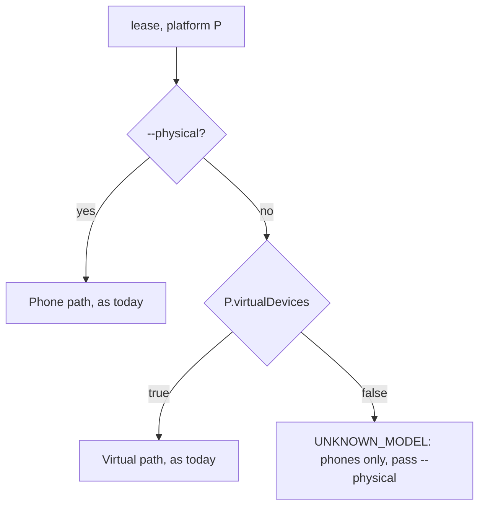

# 0078. A worker may serve a platform's enrolled phones only

- **Status:** Proposed
- **Date:** 2026-11-16
- **Issue:** [#1588](https://github.com/callstackincubator/simlock/issues/1588) (request [#1181](https://github.com/callstackincubator/simlock/issues/1181))
- **Narrows:** [ADR 0022](0022-a-physical-device-is-a-second-device-type-the-core-knows.md)
  (the platform a worker has a driver for is no longer always one it
  makes simulators or emulators for) and
  [ADR 0009](0009-gateway-routing-is-a-list-of-stages.md) §4 (one more
  reason a model is listed by no worker).

## Context

A worker with a platform's tools makes simulators or emulators for every
lease on that platform that does not pass `--physical`. An operator who
tests only on enrolled phones cannot stop that:

- A lease without `--physical` never gets a phone (ADR 0022), so an agent
  that forgets the flag gets an emulator, on a machine its operator meant
  for phones.
- The capacity limits count only virtual devices, and are at least 1.
- The warm pool, a configured target and a learned kind boot devices of
  their own.

## Decision

### 1. A per-platform key turns the platform's virtual devices off

`ios.virtualDevices` and `android.virtualDevices` are booleans, default
`true`, set like any key and read at start. They are core keys beside
`defaultMode` and `defaultModels`, not driver keys: core, leasing and the
gateway act on them, and a driver does not. Every driver keeps starting
as today, so the phones of that platform are served as today.

### 2. With it off, nothing makes, boots or keeps a virtual device of that platform

- A request that does not pass `--physical` is refused at once, before
  any catalog read or download: `UNKNOWN_MODEL`, with a message that
  names the key and `--physical`. It never waits.
- Warm targets and learned kinds resolve through the same step, so they
  are refused there too and boot nothing.
- At start, every idle virtual device of that platform is destroyed. A
  leased one runs to its release and is destroyed then, as every virtual
  device is.
- Saved baselines and installed components stay on disk. An operator may
  still install and remove components.

### 3. A worker says so in its catalog, and a gateway gives the same answer

The worker's catalog entry for that platform lists no model, no runtime
and no image, and carries `virtualDevices: false`. The entry stays, so a
gateway still routes phone requests to that worker. A gateway refuses a
request without `--physical` with the phones-only message when every
known worker that has the platform reports `virtualDevices: false`.

## Alternatives rejected

- **Allow `0` for the capacity limits.** The limits would then mean two
  things, and an agent that forgets `--physical` would wait or get
  `NO_CAPACITY`, not a message that tells it what to pass.
- **Serve a request without `--physical` with a phone.** The same command
  would mean different things on different workers. Emulator-only options
  (`--mode`, `--image-tag`, model names from the catalog) would need new
  rules, and a gateway would have to choose between phones and emulators
  on behalf of the caller.
- **A driver key under `drivers.<platform>`.** That section holds where a
  driver keeps its files, not what the worker serves, and a driver does
  not act on this key.
- **A new error code.** `UNKNOWN_MODEL` already means "nothing here could
  ever serve this request", and the gateway already gives it when no
  worker lists a model. A new code would reach every client and error
  table for no change in how a caller reacts.

## Consequences

- An agent behind a phones-only worker reads one message and passes
  `--physical`.
- A phones-only Android worker still needs the whole Android SDK, because
  the driver starts only when the emulator tools are there. Starting
  Android with only `adb` is left to a later request.
- The catalog entry gains one field, so the protocol moves up by one. An
  older gateway drops the field and gives its generic `UNKNOWN_MODEL`
  message.
- Learned kinds of that platform are forgotten by the catalog check,
  since the catalog lists none of their models. They are learned again
  after the key is turned back on.

The rows, messages and the order of the checks are in
[#1588](https://github.com/callstackincubator/simlock/issues/1588).
