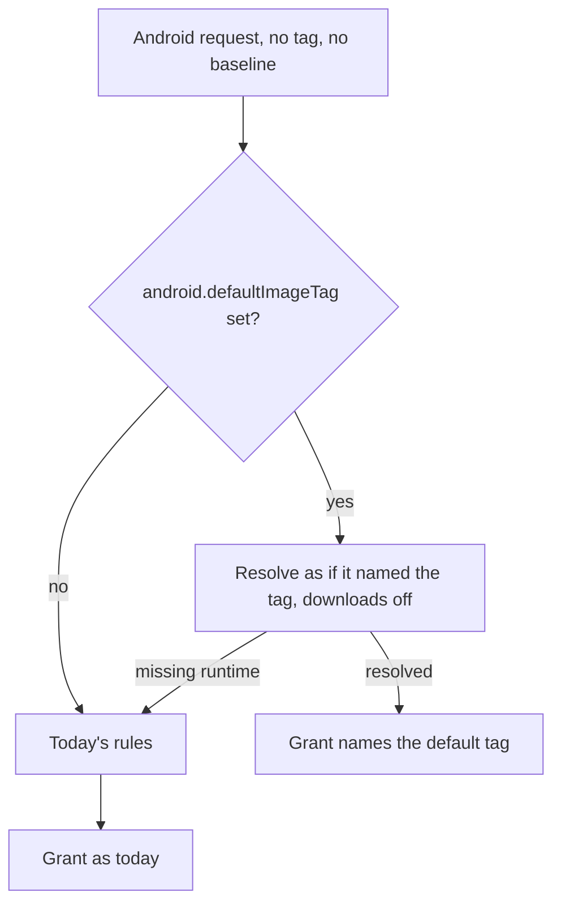

# 0078. An Android worker tries its default image tag first, and a lease falls back to none

- **Status:** Accepted — not yet implemented
- **Date:** 2026-11-16
- **Issue:** [#1590](https://github.com/callstackincubator/simlock/issues/1590) (request [#1220](https://github.com/callstackincubator/simlock/issues/1220))
- **Supersedes:** nothing. Narrows [ADR 0025](0025-simlock-ships-android-profiles-and-a-model-pairs-only-with-images-that-fit.md)
  §4: on a worker with a default image tag, an Android lease that names no
  tag does not start from the newest level with any fitting image. ADR 0015
  §5 and §7 stand: the level is picked as for a tagged request, and the
  grant names the tag the device has.

## Context

An Android lease that names no image tag gets the newest API level with a
fitting image, then a `google_apis` image for the host's CPU at that level
(ADR 0025 §4). Some clients cannot pass `--image-tag`: a device picker that
sends only platform and model is one. On a worker that has Play Store images,
those clients never get one. That makes Google Play Billing untestable through
them (#1220).

iOS has the same shape for the device mode. A request that names no mode
gets the worker's `ios.defaultMode`, which leasing applies in one place, and
the worker's catalog carries it so a gateway can route by it (ADR 0007 §2,
ADR 0066 §5).

Unlike the mode, an image tag cannot always be met. Some models take no Play
Store image (Pixel 6, TV, Wear), and some levels have none installed.

## Decision

### 1. A worker setting, read where the mode default is read

`android.defaultImageTag` is an optional worker setting. Unset, nothing
changes. It applies only to a virtual Android request that names no image
tag and no baseline. A physical request has no image tag, and a baseline
fixes its own tag (ADR 0061 §5).

### 2. Tried first, then the request as it came

Leasing's spec resolver is the one place a request with no tag gets the
default. It runs the request once as if it named the default tag: the same
model, class, range and level rules that a tagged request follows today,
with downloads off, and the driver counts only images of the tag built for
the machine's own CPU: an emulator does not boot an image for another one.
An explicit `--image-tag` keeps today's order, which falls back to another
CPU's image. If the attempt is refused as a missing runtime (no image of the
tag for this CPU at a level the request can take, or an image that does not
fit the model), the request runs again exactly as it came, which includes
the download that it may ask for. Any other refusal is the request's answer,
since the second attempt would refuse the same way.

So with no `--os` the tag outranks the newest level. A Pixel 9 on a worker
with API 37 `google_apis` and API 36 `google_apis_playstore` gets API 36
with Play Store. With `--os 37`, it gets API 37 without Play Store, as today.

The warm pool resolves its targets through the same resolver (ADR 0038), so
a target with no tag warms what a lease would get.

### 3. The catalog carries the default, and the gateway reads it per worker

A worker's Android catalog entry names its default tag, as its iOS entry
names its default mode. A gateway reads it per worker when it checks for a
warm device. A worker that does not send it has no default, and the
protocol's lowest version stays where it is, so an older worker still
joins. The gateway's merged catalog names a default only when every Android
worker reports the same one, as it does for the default runtime. Whether a
worker can serve a request is unchanged, because the fallback is always
today's answer.

The gateway cannot see whether an image fits a model (ADR 0025 rejected
listing fitting tags per model). For a model that takes no image of the
tag, it may look for a warm tagged device that the worker would never pick.
That only ranks workers, so the lease is still served.

### 4. An unmet setting is reported, not refused

`simlock doctor` reports an advisory when no installed system image has
the configured tag for the machine's CPU. The worker starts and serves as it would without the
setting.

## Consequences

- Tagless Android leases on a worker with the setting may get an older API
  level than before, the newest one with the tag.
- An idle device made without a tag no longer serves a tagless lease that
  now resolves to the tag. It ages out under the idle rules.
- One catalog field and one config field: the protocol is bumped.
- A caller who needs a `google_apis` image on such a worker names
  `--image-tag google_apis`. That is a pool of its own: an idle device made
  without a tag does not serve it.
- Play Store images refuse `adb root` and `adb remount`, so a tagless lease
  that relied on root on a `google_apis` image needs that flag once the
  setting is on.

## Alternatives considered

- **A gateway setting.** Rejected by the maintainer: a worker used without
  a gateway, by local agents or CI, would never get the default.
- **Fail like `--image-tag` when the tag cannot be met.** Rejected by the
  maintainer: every lease for a model that takes no Play Store image would
  start failing on that worker.
- **The newest level wins and the tag is used only when that level has it.**
  Rejected by the maintainer: it leaves the reporter's case unfixed.
- **A default API level as well.** Left out by the maintainer: with the tag
  steering the level it is not needed, and `--os` stays per lease.
- **Refuse to start when no image has the tag.** Rejected: removing an
  image with `sdkmanager` would stop the worker's next start.

Shapes, messages and the rows that build this are in
[#1590](https://github.com/callstackincubator/simlock/issues/1590).
