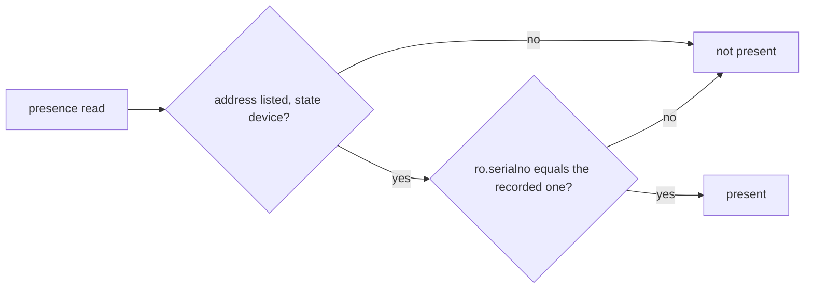

# 0079. An Android worker may enrol phones reached over the network

- **Status:** Proposed
- **Date:** 2026-11-16
- **Issue:** [#1589](https://github.com/callstackincubator/simlock/issues/1589) (request [#1250](https://github.com/callstackincubator/simlock/issues/1250))
- **Narrows:** [ADR 0022](0022-a-physical-device-is-a-second-device-type-the-core-knows.md)
  §6 ("inspect the ID over USB only … A device reachable only over the
  network is refused") and §7 ("present when its handler lists it on
  USB"); [ADR 0073](0073-a-worker-may-enrol-the-phones-plugged-into-it.md)
  §2 ("A phone reached only over the network is not listed") and §5.
- **Depends on:** ADR 0022, 0073.

## Context

A phone farm wired by Ethernet reaches its phones with `adb connect
<ip>:5555`. Their USB ports hold the network adapters, so no phone has a
USB path to a worker. Android 11 and later can also be reached by
wireless debugging: once paired, adb lists the phone under an mDNS name,
for example `adb-R58Y61A60HN-r7wg2G._adb-tls-connect._tcp`, and connects
to it again by itself.

ADR 0022 refuses any phone reached only over the network. Its reasons hold
for USB: the default adb server owns the transport, and the USB serial is
the phone's own identity. Over the network, neither holds:

- the name adb lists is an **address**. DHCP can give `192.168.1.5` to
  another phone, which would then be leased and cleaned up under the first
  phone's record;
- one phone on both USB and the network is listed twice, under two names;
- a restart of the default adb server forgets every `host:port`
  transport, and nobody connects them again.

What a worker already does: the physical-device watcher reads every
enrolled phone every `health.probeIntervalMs`, and every physical command
first passes the default server's protocol check (ADR 0022 §5).

## Decision

### 1. A worker key opts the Android driver in

The Android driver gains a worker key (named in the feature's design).
Off, the default, nothing changes: a network-only phone is refused
`network-only`. On, a network transport in state `device` counts as a
phone the driver may enrol, list as present and list for auto-enrolment.
An emulator is never one, whatever transport it is on. USB phones are
unchanged.

The key is the operator's consent for the network the worker's adb server
reaches, the way `devices.autoEnroll` is consent for its USB ports.

### 2. The ID is the address, and the hardware serial proves the phone

A network phone's ID is the name adb lists it under: what `adb -s` takes,
and what `ANDROID_SERIAL` carries in a lease. The phone's hardware serial
(`ro.serialno`) is read at enrolment and kept on its record.

- Every presence read of a network phone reads the hardware serial again.
  A different one reads not present, so no lease, reclaim or uninstall
  reaches another phone at the same address.
- A phone whose hardware serial is already enrolled, as a USB serial or as
  another record's hardware serial, is refused. One phone keeps one record
  (ADR 0022 §6 step 3).
- A phone that moves to a new address reads absent. The operator removes
  it and adds it at its new address.

Rejected: the hardware serial as the ID, with the address stored apart.
One record per phone whatever its address, but the core would map an ID
to an address for every lease and command, and a phone listed twice would
need a rule for which transport to use.

### 3. The worker reconnects the phones it enrolled

On every watcher tick, the worker runs `adb connect <host:port>` for each
enrolled `host:port` phone that the default server does not list, behind
the protocol check and within a time limit. It connects only enrolled
addresses. It never runs `disconnect`, `pair` or `tcpip`, and it still
never starts or stops the server on purpose. A wireless-debugging phone
listed under an mDNS name is left to adb, which connects it again itself.

`adb connect` exits 0 when it fails, so the worker reads the outcome from
the next listing, never from the exit code.

Pairing a wireless-debugging phone (`adb pair` and its code) stays the
operator's job. Simlock never handles a pairing code.

Rejected: the operator keeps every transport up. Every farm would keep a
script, and one restart of the default server would leave the whole farm
absent.

### 4. Auto-enrolment covers network phones under both keys

With this key and `devices.autoEnroll` both on, the host-level list of
ADR 0073 §2 also lists the network phones the default server lists. The
operator runs `adb connect` once for each phone; the worker enrols it and
keeps it connected from then on.

### 5. Safety

Safety rules 1, 7 and 8 gain one exception each, under this key only:

- the host-level list includes network transports;
- `device add`'s read-only inspection, and the hardware-serial read of a
  presence check, may reach a phone that answers at an enrolled address
  but is not the enrolled phone. Both are reads; nothing destructive runs
  until the serial matches;
- `adb connect` runs for an enrolled address.

## Consequences

- A developer's own Wi-Fi phone connected to a worker with both keys on is
  enrolled and leased. The docs say so next to the key.
- Anyone on the network who can reach a phone's adb port and has an
  authorized key can drive it outside Simlock. adb over TCP is as open as
  the network it runs on; this is the operator's to secure.
- Every presence read of a network phone costs one more `getprop`.
- The physical record gains one optional field in the core's schema. The
  contract does not carry it, and the driver's new key is no contract
  shape change.
- A phone that changes address needs a `device remove` and a `device add`.
