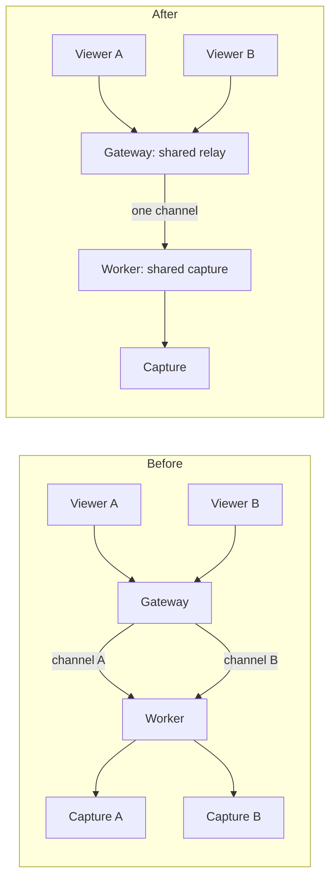
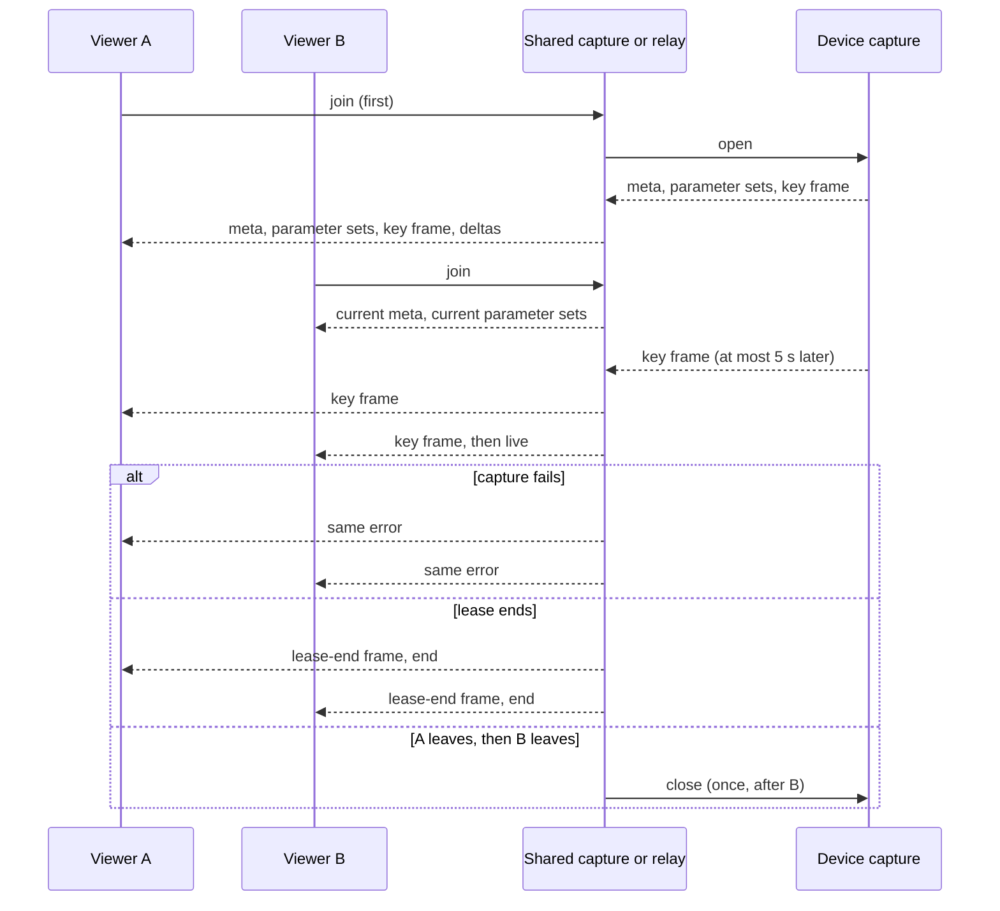

# 0079. One capture per device is shared by every viewer, and every capture sends a key frame at least every 5 s

- **Status:** Proposed
- **Date:** 2026-11-16
- **Issue:** [#602](https://github.com/callstackincubator/simlock/issues/602)
- **Narrows:** [ADR 0045](0045-a-devices-screen-streams-to-operators-not-a-leases.md)
  §5 ("One capture per viewer, as today"). Its §4 ends stay: a shared
  capture ends when its device stops running or its lease ends.

Shapes, bounds and messages live in the feature's design tables (#602);
this record holds the decisions and why.

## Context

Every viewer of a device's screen starts its own capture on the worker
(`src/stream/worker-link.ts:57-96`): two console tabs on one simulator run
two `simlock-screen-capture` programs, and two on an emulator run two scrcpy
servers. Through a gateway each viewer holds one link channel to the worker
(`src/stream/gateway-link.ts:53-62`). A link carries at most 64 at once
and the 65th waits (`src/link/index.ts:32,125-139`), so viewers can hold
back agent-device calls to that worker.

Every read is pull-based, so a viewer that stops reading slows its own
capture. Nothing is ever dropped.

A shared capture means a viewer can join in the middle, after the key frame
a decoder needs to start. Today a key frame comes only when the encoder
chooses one:

- iOS (simulator and iPhone, one shared encode loop) forces one on the
  first frame only. The encoder's own interval is `fps × 5` **frames**
  (`H264Encoder.swift:212`), and its timestamps are a frame counter
  (`H264Encoder.swift:96-97`). A still simulator gives 5 frames a second
  (its idle floor), and a still iPhone's last picture is fed again every
  200 ms. That makes about 30 s between key frames at 30 fps.
- Android (scrcpy v5.0.1) was measured on an API 35 emulator on 2026-11-16.
  A still screen sent **no frame in 12 s**. Scrolling for 16 s at scrcpy's
  default interval sent **no key frame**. With `i-frame-interval=5` it sent
  one after about 10 s (the encoder counts frames at a nominal 60 fps).
  scrcpy's reset video message (17) gave a new session, parameter sets and
  a key frame within 0.1 s.

## Decision

### 1. One capture per device on a worker

Every viewer of a device on its worker shares one capture, whether it asked
by the device path or by a lease path. The capture belongs to the device,
as 0045 keyed it. The first viewer to pass the device checks opens it.
Later viewers join it, including one that comes while it is still starting.
It closes once, when its last viewer leaves, or when its device stops or its
lease ends. A capture that fails to start or fails mid-stream fails every
viewer it serves the same way, and the next viewer starts a fresh one.

### 2. One relay per worker and target on a gateway

A gateway shares one relayed stream between its viewers of one target on
one worker: a device, or a lease by the worker's own id. A device-path
viewer and a lease-path viewer of the same device use two relays, because
a gateway does not know a lease's device before the worker answers. The
worker still runs one capture for both.

A gateway shares a relay only when the worker's answer promises §5's key
frames, in a response header. A worker that has not been updated yet makes
no promise, and each of its viewers keeps a relay of its own, as today.
Workers update one at a time, after their leases end, so such a worker can
sit behind an updated gateway for hours.

The relay belongs to the gateway, not to the first viewer. It ends when its
last viewer leaves or the worker ends it. Each viewer's access is still
checked before it joins, and each viewer's own `expiresAt` deadline ends
only that viewer.

### 3. A gateway reads frame headers and meta frames, never a picture

To start a joiner and to drop frames for a slow viewer, the gateway splits
the relayed body into frames. It reads each frame's 4-byte length and its
tag byte. It reads a meta frame's JSON (codec, size, frame rate) with the
same check a worker gives a capture's first meta frame, so that a joiner's
headers give the size after a fold. It never reads a picture's bytes. The
bound on a frame's size is the same one a worker applies to a capture. A
body that breaks the envelope or carries a meta frame that fails the check
ends the relay and every viewer on it.

### 4. A joiner waits for the next key frame

A joiner's stream starts with the current meta frame and the current
parameter sets, then the next key frame. The frames before that key frame
are skipped on the server, but meta frames, parameter sets and the lease-end
frame that come during the wait are passed on. The response headers give the current size. No
frames are replayed and no key frame is asked for, so a joiner can see
"starting" for up to 5 s.

### 5. Every capture sends a key frame at least every 5 s

This holds on a still screen too, on every platform:

- **iOS** (simulator and iPhone): the encode loop forces a key frame once
  5 s of frame arrival time have passed since the last key frame, whoever
  chose it.
- **Android** (emulator and phone): the stream's scrcpy server runs with its
  control channel on, and the driver sends reset video when 5 s pass with
  no key frame. scrcpy's own interval is set to 2, so a moving screen
  rarely needs a reset. The server is also told not to power the screen on
  and not to sync the clipboard, so a stream still changes no device
  setting beyond today's stay-awake on a phone.

### 6. A slow viewer drops frames, never slows the capture

The capture is read as fast as it delivers. Each viewer has a bounded
queue. Past the bound, its queued pictures are dropped and new ones are
skipped up to the next key frame. Meta frames, parameter sets and the
lease-end frame are never dropped. A slow viewer is never cut off, and no
limit is set on viewers per device.

## Consequences

- `src/stream/AGENTS.md` loses its two Known gaps. Its gateway rule becomes
  "reads the headers and each frame's length and tag, never a payload".
- The Android screen manual's rules gain the control socket and the reset.
  Its gaps about scrcpy's key-frame interval and about two viewers' stay-awake
  setting go, and the dark-phone gap above is added.
- A viewer that joins a still device sees its first picture up to 5 s later
  than today, where it got a capture of its own.
- On a still Android screen, scrcpy's encoder restarts every 5 s.
- While moving, key frames come more often at the same bitrate, so the
  picture is slightly softer.
- A viewer that joins a phone whose screen went dark mid-stream (off its
  charger) gets no picture until the screen is on again or the lease ends.
  Today its own capture would wake the phone first. Accepted as a known gap.
- A third-party viewer needs no change: its stream still starts with meta,
  parameter sets and a key frame.

## Alternatives considered

- **Replay from the last key frame.** A joiner would get a picture at once,
  for about 2 MB per watched device. Rejected by the maintainer: a joiner
  waits for the next key frame, and the 5 s promise bounds that wait.
- **Ask the encoder for a key frame when a viewer joins.** Picture within one
  frame time. Rejected: a command channel into both capture programs, a
  full key frame for every viewer at each join, and nothing for a still
  phone on its own. The periodic bound covers joins without it.
- **scrcpy's `i-frame-interval` alone on Android.** Rejected on the
  measurement above: it counts frames and sends nothing on a still screen.
- **A duration limit in VideoToolbox.** Rejected: its timestamps are a frame
  counter, so the duration would count frames too.
- **Share on the worker only.** Smaller, and the gateway would stay
  body-blind. Rejected by the maintainer: viewers would still hold one link
  channel each.
- **A viewer limit per device, as the device input's 8.** Rejected by the
  maintainer: a joiner costs a bounded queue, not a capture.
- **Cut off a viewer that stays behind.** Rejected: its queue is bounded, and
  a background tab catches up at the next key frame.

## Verification

The stream module's tests drive a shared capture and a shared relay with
faked drivers and a faked fleet. The iOS encode loop's tests drive the key
frame bound with fake frames. The Android session's tests drive the reset
with a fake clock and target. One slow-lane run per platform proves a key
frame at least every 5 s on a still screen. The feature's tasks name them.
