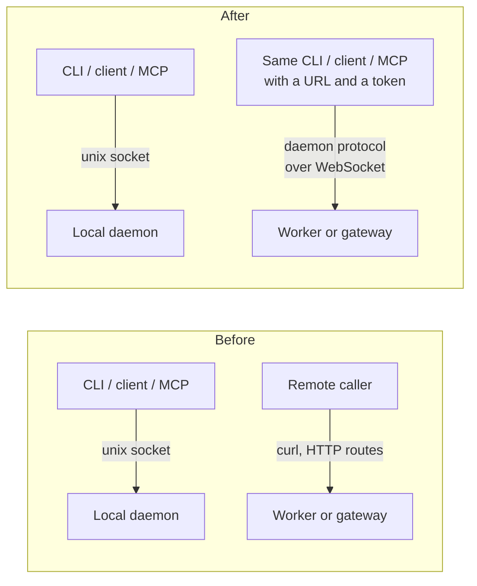
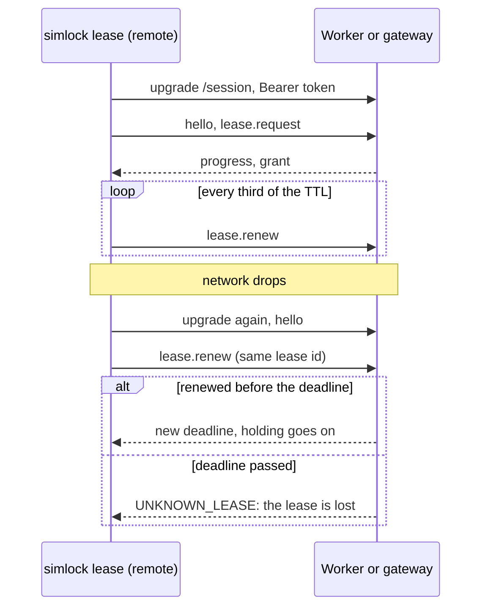

# 0081. A remote caller speaks the daemon protocol over one WebSocket path, with its token's identity

- **Status:** Accepted — not yet implemented
- **Date:** 2026-11-17
- **Issue:** [#1635](https://github.com/callstackincubator/simlock/issues/1635) (request [#945](https://github.com/callstackincubator/simlock/issues/945))
- **Narrows:** [ADR 0003](0003-one-typed-daemon-contract-behind-every-frontend.md)
  §4 ("The principal is declared once at `hello`"), §5 ("Admin authority
  comes from a credential in the handshake") and §10 ("the CLI needs
  none" [reconnect]); [ADR 0005](0005-gateway-and-worker-modes.md) §19c
  ("The CLI speaks the unix socket only").
- **Depends on:** ADR 0003, 0005.

## Context

The `simlock` CLI, `simlock/client`, `simlock/admin` and `simlock mcp`
reach a daemon only through its local socket. A coding agent on a laptop,
or a CI job on a Linux runner, has no daemon of its own, so it cannot run
`simlock lease` against a shared worker or gateway. It writes curl calls
against the HTTP API instead, one per step. `simlock tunnel` is the one
command that takes a URL and a token.

Two facts make a different answer cheap:

- The client's wire needs only a connection that sends and receives text
  (`IpcConnection`, `src/ports/ipc.ts`). It does not care what carries it.
- A worker's link to its gateway already carries this same protocol over a
  WebSocket on the gateway's one HTTP port (`/v1/uplink`, ADR 0005 §4),
  and a standalone worker already accepts WebSocket upgrades for lease
  sockets on its HTTP port.

The HTTP API covers an agent's basics (lease requests, renew, release,
exec, files), but most operations have no route, it has no pushes and no
protocol version check.

## Decision

### 1. One session path carries the daemon protocol

A standalone worker and a gateway accept a WebSocket upgrade on one new
path of their HTTP listener. Each text message carries what one line of
the socket protocol carries today: `hello`, requests, replies and pushes,
unchanged. The same dispatcher serves it (ADR 0003 §2). The path's name,
message bounds and close codes are in the feature's Interfaces table.

A worker that has joined a gateway keeps HTTP off (ADR 0005), so a remote
caller of a fleet speaks to the gateway, never to a worker.

### 2. The token at the upgrade is the identity

The upgrade is authenticated as every HTTP route is (`requireAuth`,
`src/auth`): a bearer token, or a proxy-signed identity under the same
cross-site check other upgrades get. A worker join token is refused, as on
every HTTP route. The session's role is the token's role as HTTP maps it
(operator → `admin`, agent → `agent`), and its principal is the token's,
as for HTTP (ADR 0003 §4: "For HTTP the principal is the token's
requester id").

So, on this path only, `hello` decides neither: the principal a `hello`
names is not believed, and a `hello` credential is refused rather than
used, so one connection never carries two identities. Everything else in
`hello`, the protocol range above all, works as on the socket. A session
opened by an identity with an expiry (a proxy JWT) ends at that expiry,
as HTTP streams do. Because the token is checked once, at the upgrade,
`token.revoke` closes every open session of that token at once, as a
gateway already closes a revoked token's uplinks; otherwise a leaked
token would keep its rights for as long as a session stays open.

### 3. Frontends choose remote by a URL

Given a URL (`--url`, else `SIMLOCK_URL`) and a token (`--token`, else
`SIMLOCK_TOKEN`), the CLI, `simlock mcp` and the typed clients connect to
the session path instead of the local socket. The URL rule is the one
`simlock tunnel` has. Every command whose work is the daemon's runs as it
does locally, with the token's role; a command that acts on this machine
(starting, installing or stopping the local daemon, `setup`) is refused in
remote mode. `simctl` and `adb` become `device.exec`, as through a gateway
(ADR 0005 §19c), so their paths are the worker's and a relative path names
the lease's folder. Files move over the existing lease-files routes, which
stay HTTP: a WebSocket message is no place for a 2 GiB build. They stay
single files, as ADR 0067 has them; a folder such as an iOS `.app` is
not uploaded here. In remote mode a command picks its default lease by
the caller's requester id, not by the token, since one token may serve
several agents.

### 4. A held lease outlives a dropped connection while its TTL lasts

The client still never reconnects (ADR 0003 §10). The frontends that hold
a lease across time, the held `simlock lease` and `simlock mcp`, reconnect
after a dropped connection and keep renewing until the lease's deadline.
A lease is TTL-first (ADR 0004), so a connection was never what kept it
alive; reconnecting acquires no device, it only renews one the caller
already holds. Only when the deadline passes without a renew is the lease
lost. A drop before the grant re-attaches to the same request by its
idempotency key, which a worker and a gateway already answer with the
waiting request instead of a second one, so a granted device is never
left with nobody renewing it. A drop that sends no close (sleep, a Wi-Fi
switch) is noticed by silence: the farm pings, and a client that hears
nothing for a bounded time treats the connection as lost. Locally a
dropped socket still ends the held command as today: the daemon going
away is not a network blip.

## Consequences

- Every operation reaches a remote caller with no route of its own:
  `release --all`, `cleanup`, `token create` and the rest work against a
  farm with an operator token. This puts `nuke` and `cleanup` on the
  network, behind an operator token, as `/v1/leases` and `/v1/tokens`
  already are.
- The HTTP API stays for curl, the console and other languages. It is no
  longer the only remote path, and a new operation needs no route to be
  usable remotely.
- A contract shape change now reaches remote callers too: a CLI of
  another version gets `PROTOCOL_VERSION_UNSUPPORTED` at `hello`, as a
  local one does, instead of a route that answers differently.
- An agent token was already shell access to its worker (`device.exec`).
  This adds no power to it, only a second way in.
- Tokens are per daemon (a gateway's tokens are the gateway's), and a
  token shared by several agents is still one principal (#1407).

## Alternatives considered

- **Every command calls the HTTP API.** Needs a route for every operation
  the CLI calls, many of them admin, and polling where the socket pushes
  (progress, `lease-lost`, events). Two wires to keep in step forever.
  Rejected.
- **Open the uplink path to agents.** `/v1/uplink` takes only join tokens
  and makes the caller `admin` by acceptance (`src/daemon/server.ts`),
  and exists only on a gateway. Rejected: its trust model is the
  worker's, not a caller's.
- **The user tunnels the socket (ssh `-L`).** Works today for one
  machine with ssh access, not for a CI runner or a gateway behind a
  proxy, and the daemon would see a local peer with a local identity.
  Rejected as the answer; still possible.
- **The client reconnects by itself.** ADR 0003 §10's reason holds: a
  shared retry is a trap the moment it touches a mutation. Only the two
  frontends that hold a lease reconnect, and only to renew.
