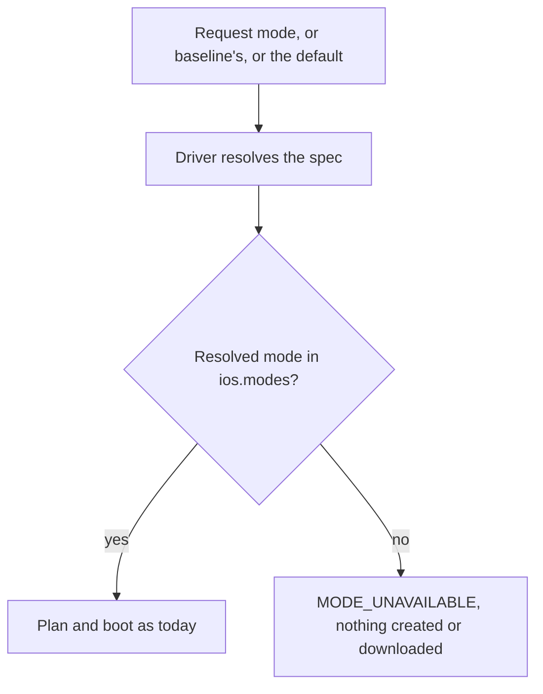
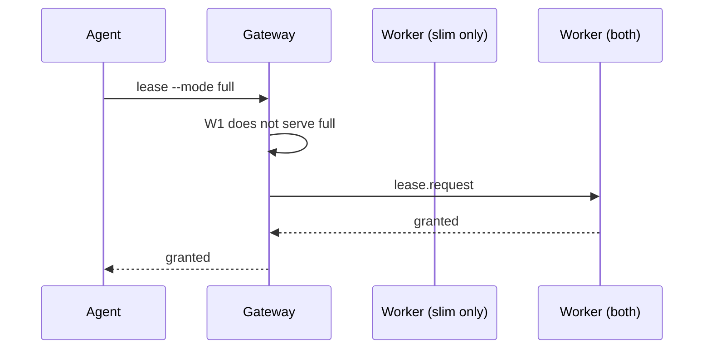

# 0082. A worker may serve only some iOS device modes

- **Status:** Accepted — not yet implemented
- **Date:** 2026-11-17
- **Issue:** [#1645](https://github.com/callstackincubator/simlock/issues/1645) (request [#1557](https://github.com/callstackincubator/simlock/issues/1557))
- **Narrows:** [ADR 0007](0007-a-lease-request-chooses-the-device-mode.md)
  §3 ("Every worker honours both modes") and §4 ("It is never an error");
  [ADR 0009](0009-gateway-routing-is-a-list-of-stages.md) §4 (the table
  gains a row) and §5 (one more "cannot serve" code);
  [ADR 0008](0008-the-catalog-pairs-models-with-runtimes-and-status-carries-host-facts.md)
  §1 (the iOS catalog entry gains a field).
- **Depends on:** ADR 0007, 0009, 0065, 0066.

## Context

A full iOS simulator runs every system service; a slim one (ADR 0060)
turns the heavy ones off and uses much less memory. ADR 0007 lets each
lease request pick its mode, and makes every worker serve both (§3). A
worker's `ios.defaultMode` only sets the mode of a request that names
none.

An operator whose worker is short of memory wants no full simulator on
it at all. Today they cannot stop one: a client may ask `--mode full`, a
slim request on iOS below 18.5 quietly becomes full (§4), and warm-pool
targets, learned kinds and full baselines boot full devices with no
request at all.

Through a gateway, a worker that refused a mode would also need the
gateway to send full requests elsewhere: today a code the gateway does
not class as "cannot serve" is a final answer.

## Decision

### 1. A worker key lists the iOS modes it serves

`ios.modes` is a list of `slim` and `full`, at least one, no repeats.
Unset, it is both: every worker serves what it serves today. It is a
core key of the `ios` section, beside `defaultMode` (ADR 0065), because
leasing, the warm pool, the catalog and the gateway act on it, and the
driver does not.

The default mode must be served. When `ios.defaultMode` is unset and only
one mode is listed, that mode is the default. A `defaultMode` that is set
and not listed fails the config load.

Android gets no key: its driver never slims, so a list could only say
`full`.

### 2. The check is on the resolved mode, in leasing's one resolve step

Leasing checks the asked, default or baseline mode before it resolves the
spec, so nothing is downloaded for it, and checks the mode the driver
resolved after, so a slim request that would fall back to full (§4 of ADR
0007) is refused on a worker without full instead of being granted full.
Lease requests and warm targets pass that one step, so both are refused
the same way, and a warm target that cannot be met is reported by doctor.
Learned kinds are planned from their stored spec, so the warm pool's own
catalog check forgets one whose mode is not served.

A slim boot whose readback fails still records `full` (ADR 0007 §8) and
is granted as today: the check is a planning rule, not a promise about
what the OS did.

### 3. A new error code

The refusal is `MODE_UNAVAILABLE`: exit 12 and HTTP 422, the group for
"this machine cannot provide it". Its message names the mode and the key.
It is a new code rather than `UNKNOWN_MODEL` or `BAD_REQUEST` because the
model is fine and the request is valid elsewhere in a fleet; a client
can tell it apart and ask for the other mode. Its `lease.rejected` reason
is `unresolvable-spec`, like every other resolve refusal.

### 4. The catalog says which modes a worker serves, and a gateway routes by it

A worker's iOS catalog entry carries `modes` when it serves only some.
Absent means both, so a worker from before this change reads as serving
both. The gateway's merged entry carries the union.

A gateway sends a request whose mode is known (named, or a baseline's)
only to a worker that serves it. When no known iOS worker serves it, the
request fails at once with `MODE_UNAVAILABLE`: a new row of ADR 0009 §4,
after "no known worker has the platform". A request with no mode goes to
any worker and gets that worker's default, which it serves by §1.

A worker's own `MODE_UNAVAILABLE` before a progress push counts as
"cannot serve" (ADR 0009 §5): the gateway leaves that worker out for that
request and tries the others.

## Consequences

- A full request on a slim-only worker fails at once; it never waits.
- A worker with `ios.modes: ["slim"]` never boots a full iOS simulator
  for any request, target or baseline. A slim pass that fails at boot is
  the one way such a device can still run full.
- The catalog field and the new code move the protocol by one.
- An older gateway strips the field and relays the code as a final
  answer: behind it, a full request that one worker refuses is not tried
  on another.

## Alternatives considered

- **`ios.fullMode: false`, a boolean.** Simpler, but it can only turn full
  off; a list names what the worker serves in the request's own words.
- **Reuse `UNKNOWN_MODEL` or `BAD_REQUEST`.** No new code, but the first
  points the caller at the model list and the second says the request was
  wrong, when another worker could serve it.
- **No catalog field; the gateway retries on the worker's refusal.**
  Cheaper, but each request costs a round trip per refusing worker, and
  when none serves the mode the caller gets one worker's answer instead of
  the fleet's.
- **Keep the slim-to-full fallback on a slim-only worker.** It would
  grant exactly the device the operator turned off.
