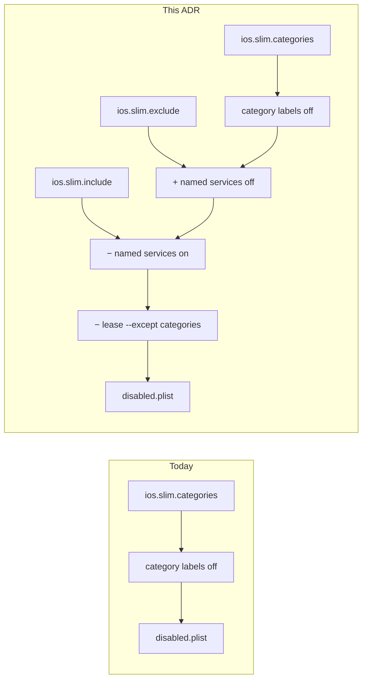

# 0082. A worker may turn single slim services on or off beside its categories

- **Status:** Proposed
- **Date:** 2026-11-17
- **Issue:** [#1644](https://github.com/callstackincubator/simlock/issues/1644) (requests [#1556](https://github.com/callstackincubator/simlock/issues/1556), [#1552](https://github.com/callstackincubator/simlock/issues/1552))
- **Narrows:** [ADR 0060](0060-ios-slim-writes-launchd-overrides-while-the-simulator-is-shut-down.md) §1 (the managed labels gain the worker's named services, and a never-disable label may be written `true`) and §2 (a device is `slim` only when some label is written `true`); [ADR 0066](0066-a-slim-lease-may-keep-named-categories-running.md) §2 (a kept category also wins over a service the worker turns off by name).

## Context

A worker slims whole categories (`ios.slim.categories`). Two requests
need one service at a time:

- #1556 keeps push, assets and StoreKit running while the rest of their
  categories stay off. Today the only way is to drop the whole category.
- #1552 turns off `com.apple.diagnosticd`, which no category lists. On one
  x86 VM with iOS 26.5 it cost 7–11% of a core per booted simulator. It
  must stay opt-in: without it `log stream` inside the simulator breaks.

The file of ADR 0060 handles it. Checked on 2026-11-17 on iOS 26.4
(23E254a), a throwaway iPhone 17 in a private device set: with
`com.apple.diagnosticd` written `true` before the boot, the boot finished,
`print-disabled` listed it disabled and no `diagnosticd` ran under the
runtime root; with the file removed and a reboot, it ran.

A lease's `--except` (ADR 0066) keeps whole categories, per lease. Both
requests are about the worker, not a lease.

## Decision

### 1. Two worker lists of service names

The worker config takes `ios.slim.include` (services that run anyway) and
`ios.slim.exclude` (services that do not run), beside
`ios.slim.categories`. Both hold launchd service names, never categories.
A name in both lists fails the config load. Neither reaches a lease
request, the catalog or a gateway.

### 2. What a slim device turns off

The services written off are those of the worker's categories that the
lease does not keep, plus `exclude`, minus `include`. The services of a
category the lease keeps are always written on. A kept category wins over
`exclude` for its own services, as it already wins over a slimmed
category that lists the same one: the lease asked for it running.

`exclude` wins over simslim's never-disable list: the operator named the
service. Every name in either list becomes a managed label (ADR 0060 §1),
written `true` or `false` on every `prepare`.

### 3. The readback keeps ADR 0060's rules for these names

An `include` or `exclude` service not read back as written grants `full`,
and a readback that cannot run grants `slim`, as for any managed label. A
`full` device runs every service, so an `include` service runs there too.
Only a lease's `--except` keeps ADR 0066's stricter rule.

### 4. Slim means some service is off

A device is `slim` only when at least one label is written `true`. So
`categories: []` with an `exclude` is a slim worker, and a configuration
or an `--except` that leaves nothing off grants `full`, as today.

## Consequences

- #1552's setup is `categories: []`, `exclude: ["com.apple.diagnosticd"]`,
  with slim leases.
- Simlock cannot tell a misspelt name: launchd reads back whatever the
  file says.
- A name dropped from `exclude` is no longer managed. A baseline saved
  while it was excluded keeps it off in its copies; putting it in
  `include` turns it back on.
- No protocol change; the catalog's `slimCategories` stays the categories.

## Alternatives considered

- **Fail the boot when an `include` service is off, as `--except` does.**
  Every slim boot on such a worker would fail whenever the readback times
  out under load, where it grants `slim` today; a plain slim boot that
  fails is not retried. Rejected by the maintainer.
- **A `diagnostics` category for #1552.** Turns the service off for every
  worker that leaves `categories` unset, which breaks `log stream`.
- **Names on a lease (`--except` of a service).** Out of scope for now;
  `--except` stays categories-only.
