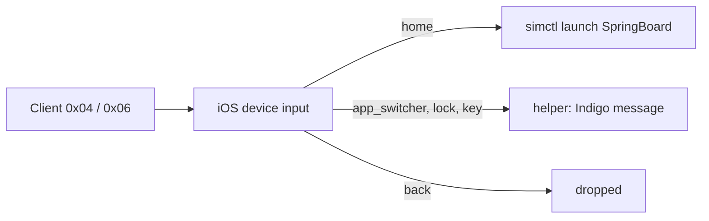

# 0085. An iOS simulator takes keys on every runtime, and the app switcher and Lock

- **Status:** Proposed
- **Date:** 2026-11-17
- **Issue:** [#1024](https://github.com/callstackincubator/simlock/issues/1024)
- **Narrows:** [ADR 0049](0049-a-lease-holder-watches-and-drives-its-devices-screen.md)
  §4 ("Where keys cannot be injected (an iOS 27 runtime), `0x82` says
  `keyboardUnavailable`"; "the app switcher and Lock are dropped") and its
  consequence "On iOS simulators they also cannot type hardware keys on iOS
  27 runtimes or press the app switcher or Lock".

## Context

ADR 0049 dropped hardware keys on iOS 27 runtimes, and the app switcher and
Lock on every iOS simulator. Simlock never measured either drop. Both came
from serve-sim's notes: "the iOS 27 guest no longer consumes" the Indigo
keyboard message, and "Xcode 26+ silently drops" the Indigo Home press,
which serve-sim also uses for the app switcher.

On 2026-11-17 the vendored helper was measured on a simulator in a custom
device set, with neither DeviceHub nor Simulator.app running. The Mac had
Xcode 26.4.1, 27.0 and 27.2 and one CoreSimulator (1174.21, from Xcode
27.2):

| Sent by the helper                          | iOS 26.4 | iOS 27.0 | iOS 27.2 |
| ------------------------------------------- | -------- | -------- | -------- |
| Indigo key message (keys `a`–`h`)           | typed    | typed    | typed    |
| Indigo button, source 1 (Lock)              | locked   | locked   | locked   |
| Indigo Home pressed twice, 0.05–0.2 s apart | switcher | switcher | switcher |

The SimulatorKit of each of the three Xcodes gave the same results. Once,
on a freshly booted iOS 27.0 simulator, the first two keys were lost; after
that every key arrived.

serve-sim's own way to type on Xcode 27 is to post key events to DeviceHub's
window. That needs Accessibility permission, the window in front and the
default device set (DeviceHub cannot see a custom set), so it is no option
for a headless worker.

## Decision

1. An iOS simulator's device input forwards `0x06` keys to its helper on
   every runtime, and its `0x82` never carries `keyboardUnavailable`.
2. `0x04` `app_switcher` and `lock` go to the helper. The helper sends
   `lock` as one Indigo button press (source 1), and `app_switcher` as two
   Indigo Home presses 50 ms apart.
3. `home` stays `simctl launch com.apple.springboard`, which already works;
   `back` stays dropped, since an iPhone has no Back button.
4. A press the guest ignores is not detected, and nothing tells the client,
   as for rotation (ADR 0052 §2).

## Consequences

- A person who takes over a leased iOS simulator can type on a hardware
  keyboard, open the app switcher and lock or wake the screen, on every
  runtime.
- The helper sends the Home press again, which ADR 0049's notes said Xcode
  26 drops. It does not drop it on CoreSimulator 1174.21. An older
  CoreSimulator was not measured; a worker on one may ignore these presses
  silently.
- No device sends `keyboardUnavailable` any more. The field stays in the
  `0x82` shape, which is serve-sim's.
- No protocol change: the input socket's messages are not a contract shape.

## Alternatives considered

- **Keep keys off on iOS 27 below a measured Xcode.** Rejected: an iOS 27
  runtime needs Xcode 27, every measured SimulatorKit worked, and the gate
  would rest on a version nobody showed to fail.
- **Type through DeviceHub's window, as serve-sim does.** Rejected: it needs
  Accessibility permission and the default device set, and a window in
  front.
- **Move Home into the helper too.** Rejected for now: the `simctl` path
  works, and nothing asks to change it.
- **The app switcher as a swipe up and hold from the bottom edge.**
  Rejected: it was never measured cleanly, while the double Home press
  opened the switcher on every try (5 of 5 on iOS 27.2).
