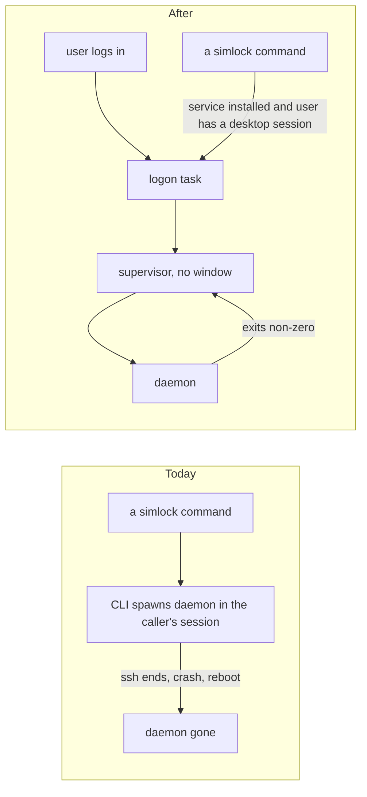

# 0086. On Windows the daemon service is a logon task that runs a Simlock supervisor

- **Status:** Accepted
- **Date:** 2026-11-18
- **Issue:** [#1691](https://github.com/callstackincubator/simlock/issues/1691) (request [#1069](https://github.com/callstackincubator/simlock/issues/1069))
- **Narrows:** [ADR 0041](0041-the-daemon-can-run-under-the-users-service-manager.md)
  §1 (Windows is no longer a usage error), §3 (how the saved
  environment reaches the daemon), §4 (who restarts it), §5 (no SIGTERM
  on Windows), §6 (what "not loaded" means, and the 10 s limit on
  launchctl and systemctl calls, which Windows does not use), §8 (the
  reboot hint) and §9 (on Windows "broken" checks the Node path and the
  supervisor entry, because the service runs a supervisor, not
  `main.js`).

## Context

On Windows `simlock daemon install` is a usage error. A daemon a command
starts lives in that command's logon session: over ssh it dies when the
ssh session ends, and after a crash or a reboot nothing starts it again.

Windows offers two per-user ways to start a program: a Windows service
and a Task Scheduler task. Measured on Windows 11 23H2 (2026-11-18):

- A service runs as a system account or needs the user's password, and
  must speak the service control protocol, which Node does not.
- A task runs as the user with no password saved. An **interactive**
  task with a logon trigger runs in the user's desktop session; a
  standard account can register and run it. A "logged on or not" (S4U)
  task runs in session 0 at boot, but a standard account cannot run one
  (it lacks the batch logon right).
- A task that runs `node.exe` opens a terminal window on the desktop, and
  closing that window ends the daemon. `conhost.exe --headless` runs the
  same program with no window.
- A task's "restart on failure" setting does not restart a program that
  exits non-zero: it covers only a task that fails to start.
- A task runs at below-normal priority unless its XML says otherwise, is
  stopped after 72 hours, and does not start on battery.
- Starting an interactive task while its user has no desktop session
  succeeds and runs nothing.
- Ending a task kills only the process it started (here `conhost.exe`);
  the programs below it keep running.

## Decision

1. **The service is a per-user Task Scheduler task.** It has a logon
   trigger for the installing user only, runs with that user's
   interactive token at the user's normal (not elevated) level, and has
   the same name as on macOS (ADR 0041 §2), in the root task folder. It
   runs at normal priority, never times out, ignores battery state, and
   ignores a second start while it runs. Install needs no administrator
   rights and stores no password.
2. **The task runs a Simlock supervisor, with no window.** The task runs
   `conhost.exe --headless` with the Node path and the supervisor entry
   that ships beside `dist/daemon/main.js`. The supervisor starts the
   daemon with the role's flag, its stdout and stderr appended to
   `daemon.log` and no window, as a child it waits on (not detached), with
   the variables install saved (ADR 0041 §3) carried in the task's own
   arguments. The supervisor holds no daemon state.
3. **The supervisor restarts after a failure only.** A daemon that exits
   0 (a clean stop, or `Daemon already running`) ends the supervisor and
   the task. A daemon that exits non-zero or is killed is started again
   10 s later, as launchd and systemd do. Each restart writes one line to
   `daemon.log`. Before each restart the supervisor reads its task: when
   the task is gone (uninstall) or names another install (a new install),
   it stops instead, so a restart loop ends with the service, as launchd's
   `bootout` and systemd's `disable --now` end theirs. Install ends the
   running task instance before it replaces the task, so its start is not
   ignored while an old supervisor waits.
4. **A stop is `daemon.stop`.** Windows has no SIGTERM. `daemon stop`,
   install and uninstall stop the daemon through the daemon contract, as
   on every platform. Ending the task in Task Scheduler stops nothing
   that matters: the daemon and its devices keep running, as launchd's
   `AbandonProcessGroup` and systemd's `KillMode=process` leave them.
5. **Not loaded means no desktop session.** The service is *not loaded*
   while the installing user has no desktop session (no process of the
   user in a session other than 0). A start then spawns the daemon as
   today with the notice ADR 0041 §6 prints, since running the task would
   do nothing. A disabled task is not loaded too.
6. **Start at login, not at boot.** As on macOS, install prints one line:
   turn on automatic login for this user to start after a reboot.

## Consequences

- A Windows worker comes back after a crash, and at every login; a
  daemon started over ssh while the user is logged in at the screen runs
  in the desktop session and outlives the ssh session.
- Emulators boot in the desktop session, with its GPU and at normal
  priority, and show their windows there unless `headless` is set.
- Over ssh with nobody logged in at the screen, commands still spawn the
  daemon, which dies with the ssh session, as today.
- Two Node processes run per role: the supervisor and the daemon.
- The doctor `service-broken` finding and `daemon status` gain the
  manager name `task-scheduler`, a contract shape change that bumps the
  protocol by one.
- `conhost.exe --headless` is undocumented. If a Windows release drops
  it, install registers the task but the task fails to start, so
  `daemon install` waits out the startup deadline and fails with
  `DAEMON_STARTUP_FAILED` after 20 s; `daemon status` shows the broken
  start.

## Alternatives considered

- **A boot task that runs whether the user is logged on or not (S4U).**
  Starts at boot with nobody logged in, but a standard account cannot
  run it and emulators would run in session 0 with no desktop. Rejected
  for parity with macOS and for standard accounts.
- **A Windows service.** Needs a system account or a saved password, and
  a service wrapper binary Simlock would have to ship. Rejected.
- **Task Scheduler's own restart, or a repeating trigger.** The first
  does not restart after a non-zero exit; the second also restarts after
  `daemon stop`. Rejected for the supervisor.
- **A Run key or the Startup folder.** Starts at login, but nothing
  restarts the daemon and nothing can start it on demand. Rejected.
- **The daemon entry as its own supervisor (`main.js --service`).**
  Loads the whole daemon into the supervisor process. Rejected for a
  small entry.
