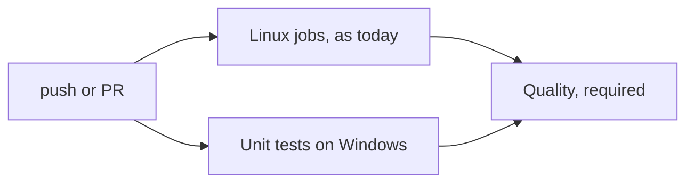

# 0087. The unit tests run on Windows in CI, and a list of files still failing there only shrinks

- **Status:** Proposed
- **Date:** 2026-11-18
- **Issue:** [#1693](https://github.com/callstackincubator/simlock/issues/1693) (request [#1070](https://github.com/callstackincubator/simlock/issues/1070))
- **Narrows:** testing rule 5 in `docs/internal/agent-rules/testing.md`
  ("never skip, disable, or quarantine a test to get to green"): for good,
  a test of a fact Windows does not have is skipped there (§3); and while
  this feature is delivered, the Windows job leaves out the files on its
  list (§4).

## Context

CI runs only on Linux. The Windows code paths are tested by passing
`platform: "win32"` to a function on Linux, so nothing that only Windows
does (a named pipe, a batch file through `cmd.exe`, a file that cannot be
deleted while it is open) ever runs. On a Windows 11 machine at
`2df19f881`, 1,664 of 9,544 unit tests fail, in 138 of 2,184 files. Most
of them fail for a few shared reasons, not for scattered fixture paths:

- The in-memory fake filesystem keys its entries on `/` paths, while the
  code under test builds paths with the host's `node:path`, which gives
  `D:\home\…` on Windows (about 710 tests).
- Android tests leave the platform to its default, so on Windows the code
  looks for `emulator.exe` in a fake SDK that holds `emulator` (260).
- Tests listen on `<folder>/daemon.sock`, which Windows refuses; the daemon
  there listens on a named pipe (176).
- The repository's own tooling tests call `sh` and `python3` (201).
- A test deletes its folder while a file in it is still open (96).
- A test checks a fact Windows does not have, such as mode `0600` (~20).

The fast e2e lane cannot run on Windows yet: its harness finds a daemon by
its socket file and `lsof`.

## Decision

### 1. A Windows job runs the unit and DOM tests, and Quality needs it

CI gets one job on a pinned Windows runner image that runs
`pnpm test:unit` on every push and pull request. The required `Quality`
check needs it, as it needs the Linux unit job. The e2e lane, the timing
tests, the console lane and the static checks stay on Linux.

### 2. The in-memory filesystem reads both path styles

The fake reads `D:\a\b`, `\a\b` and `/a/b` as one entry: it drops a drive
letter and reads `\` as `/`, for every path it is given and every link
target it stores. What it returns, such as `realpath`, is the `/` form.
Production code keeps the host's `node:path`, and no source file is given
a path flavour or a platform option to make a test pass; a test's fixtures
follow the host instead (a fake Android SDK holds `emulator.exe` on
Windows). A test that compares a path the code built builds the expected
one with `node:path`, the way the code does; one that compares a path the
fake returned expects the `/` form.

### 3. A test of a fact Windows does not have runs off Windows only

A test that checks a POSIX mode, a umask, a launchd or systemd file, or a
call Windows does not have (such as Python's `os.fork`) is skipped on `win32`, the way the e2e files
already skip by platform. That is not skipping a test to get to green:
the fact it checks does not exist there. Every other test runs on both.

### 4. A list of files still failing on Windows only shrinks

Until every file passes, the Windows job leaves out the files on one list,
read only on a Windows host. The first task adds the job with every file
that fails in any of three runs of it; each later task fixes a group of files and takes
them off. A file is never added once the job exists: a change that breaks a
file on Windows is fixed before it merges. The last task deletes the list
and this exception.

### 5. A product defect a Windows test finds is fixed in the same task

When a test fails on Windows because Simlock is wrong there, not the test,
the task that owns the file fixes the code with it.

### 6. The repository's tooling runs on Windows too

The agent scripts and their tests are made to run on a Windows host from
Git Bash with Python 3 installed, as the CI job runs them, so a
contributor on Windows can run every unit test. Running them from
PowerShell or `cmd.exe` is not supported.

## Alternatives rejected

- **A path flavour injected into the code**, the way `platform` is. About
  67 source files would take `posix` or `win32` path functions from the
  composition root, the tests would pass `posix`, and the unit tests would
  never meet a real Windows path. It changes production code to suit a fake.
- **Every fixture built with `node:path`.** About 120 test files rewritten,
  and the fake still has to read `\`; more conflicts with open work.
- **Add the job only once every file passes.** About twenty open PRs edit
  these tests; each that merges in the meantime can break a file already
  fixed, and the last task would chase them.
- **Only the tests that touch the OS.** A logic test that breaks only on
  Windows, as most of the 1,664 do, would stay unseen.
- **The e2e lane in this feature.** Its harness needs a Windows way to find
  and stop a daemon first; that is its own change.

## Consequences

- Every pull request waits for a Windows runner as well.
- While the list exists, a file on it is not run on Windows, and a defect
  only it would show stays unseen until its task.
- Windows contributors can run the whole unit suite, from Git Bash.
- An agent on a Mac reproduces a Windows-only failure by rerunning the
  Windows job, not by running it locally.
- Shapes, task split and the list's file are in
  [#1693](https://github.com/callstackincubator/simlock/issues/1693).
