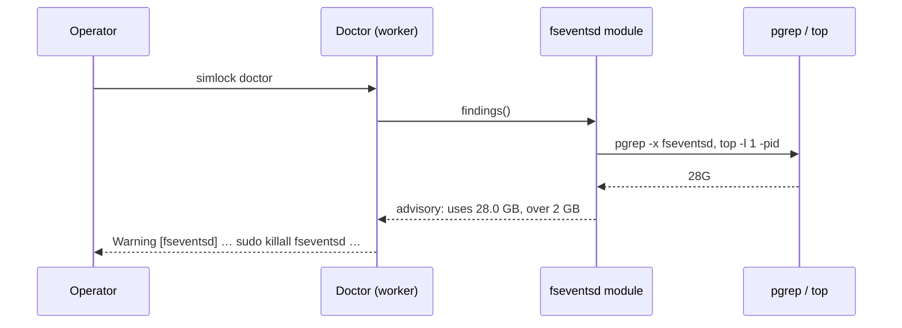

# 0088. A macOS worker checks fseventsd's memory when doctor runs, and an optional module may be on by default on a macOS worker

- **Status:** Proposed
- **Date:** 2026-11-18
- **Issue:** [#1733](https://github.com/callstackincubator/simlock/issues/1733) (request [#1618](https://github.com/callstackincubator/simlock/issues/1618))
- **Narrows:** [ADR 0030](0030-optional-modules-share-one-contract-and-load-only-when-turned-on.md)
  §2 (a missing `enabled` may load a module), §3 (`findings()` may be
  async) and §7 (a second module finding kind), and
  [ADR 0046](0046-a-standalone-worker-serves-agent-device-by-default-with-a-private-profile.md)
  §1 (a joined worker may have a module on by default).

## Context

On a macOS worker under lease churn, the macOS service `fseventsd` grows
to tens of GB until the Mac swaps (28 GB in #1618). It is a macOS bug;
restarting `fseventsd` is the only proven fix. simlock's own processes are
fine, but nothing tells the operator, who lowers capacity instead.

Restarting it needs root, and simlock runs as the operator's user. A root
part in simlock (a helper, a sudoers rule) is a privilege risk, while a
launchd job the operator pastes from the docs just works. So simlock only
warns, and the docs carry the fix. The details are in the feature, #1733.

Three accepted rules stand in the way:

- ADR 0030 §2: a module whose `enabled` is missing loads nothing.
- ADR 0046 §1: only a standalone worker may turn a module on by default; a
  joined worker keeps modules off. The bug was reported on a joined worker.
- ADR 0030 §3 and §7: `findings()` is synchronous, and its one finding kind
  is `module-unavailable`, which the CLI prints as `fail`.

## Decision

### 1. A module may be on by default on a macOS worker

A definition may declare "on by default on a macOS worker" as data, beside
ADR 0046's "on by default on a standalone worker". The config loader
resolves it without naming the module: an `enabled` that no layer sets
becomes `true` on a worker whose host OS is macOS, joined or not. On any
other OS, and on a gateway, it stays `false`, so `config.get` never shows
`true` where the module cannot run. A value the operator sets wins, and a
default is never written to `config.json`, as in ADR 0046.

### 2. A module's findings may be read live

`findings()` may return a promise. The module host awaits each module's
findings under one deadline, as it does for its stop steps; a module past
it, or one that throws, adds no finding and is logged. Doctor is the only
reader, so a check runs only when an operator asks for one, and nothing
runs on an idle worker.

### 3. A module finding may be advisory

A module finding may say it is advisory. The host then builds
`{ kind: "module-advisory", module, message, remedy }` instead of
`module-unavailable`. It is not drift: `--fix` never acts on it and
`doctor.reconciled` does not carry it. The CLI prints it as a warning. The
protocol version moves up by one.

### 4. The fseventsd module is the first to use all three

## Alternatives rejected

- **simlock restarts `fseventsd` itself**, through a sudoers rule or a root
  watchdog that simlock installs: a root part that a compromised user
  account could reach, for a fix a pasted launchd job gives anyway.
- **A background reading with a log line on crossing the limit:** a timer
  on every worker for a figure only doctor shows, and doctor would show a
  reading up to one interval old after a restart.
- **On by default on every worker:** `config.get` would show `true` on
  Linux and Windows while the capability reads `off`.
- **Reuse `module-unavailable`:** the module works, and the CLI prints that
  kind as `fail`.

## Consequences

- A macOS worker runs `pgrep` and `top` once per doctor run, about a second.
- Every macOS worker's `status` lists the `fseventsd` capability.
- Any later module may use §1 to §3 without a new ADR.
