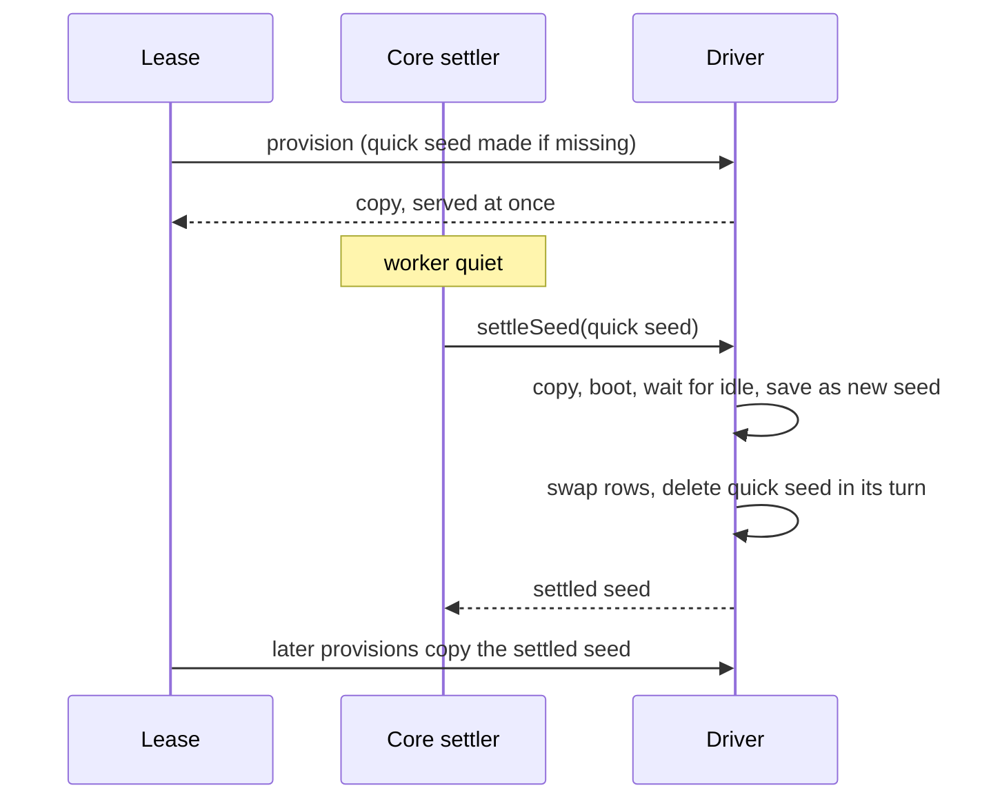

# 0090. A seed is settled in the background and replaced by its settled copy

- **Status:** Accepted
- **Date:** 2026-11-19
- **Issue:** [#1732](https://github.com/callstackincubator/simlock/issues/1732) (request [#1540](https://github.com/callstackincubator/simlock/issues/1540))
- **Narrows:** [ADR 0061](0061-every-virtual-device-is-a-copy-of-a-source-and-a-baseline-is-a-named-source.md)
  §1 (a ready seed is never booted or erased again, and no command names
  a seed but `doctor`) and §2 (an Android seed's `simlock_boot` is saved
  after one cold boot).
  [ADR 0076](0076-an-ios-clone-names-only-its-own-folders-before-its-first-boot.md)
  §1 (a seed is made by creating a throwaway, booting it once and cloning
  it unbooted) and §2 (a seed's lineage is its throwaway only).

## Context

Every virtual device is a copy of its kind's seed (ADR 0061). A seed is
saved as soon as its device takes commands. At that moment the system is
still doing first-boot work, so every copy does it again on its first
boot, during someone's lease.

Measured on one Mac (Apple silicon, 10 cores) and posted on #1732: a copy
of today's seed uses about the CPU of a brand-new device in its first 5
minutes after ready.

| | Copy of today's seed | Copy of a seed left to settle first |
| --- | --- | --- |
| iOS 27.2, iPhone 17 | about 690 core-seconds | about 455; quiet after about 3 minutes |
| Android 36, Pixel 8 | about 530 | about 65; idle from the first second |

On iOS every copy still drops its LaunchServices database and rewrites the
files naming its seed's UDID (ADR 0061 §2, ADR 0076), and boots cold, so
about a minute of work remains. On Android a copy resumes the seed's RAM
from `simlock_boot`, so a seed saved idle gives an idle copy.

Settling takes about 6 minutes on both. Making the first lease of a kind
wait for it is not acceptable.

## Decision

### 1. A seed is still made as today, and the lease that needed it is served at once

The make path of ADR 0061 §1 and ADR 0076 does not change. Its seed is a
*quick* seed.

### 2. Core settles quick seeds in the background, one at a time, when the worker is quiet

A quick seed that a lease has used is settled later. Core chooses which
seed and when; the driver does the work:

- At most one settle runs on a worker.
- A settle starts only when no boot or creation is under way and none
  ended in the last few minutes, memory pressure is `none` (ADR 0068) and
  free disk is at or above the disk-pressure threshold.
- A settle running when memory pressure reaches `new-devices-paused` is
  stopped, and its quick seed settled again later.
- The seed with the most leases since it was made goes first.
- A settle holds a creation reservation and a component claim for its
  whole run, as a provision does. A lease that arrives during a settle
  does not stop it.
- A daemon stop and a nuke abort a running settle. The quick seed stays.

### 3. A settle boots a copy, never the seed, and replaces the seed with the copy

The seed itself is still never leased or booted. A settle copies the
quick seed exactly as a provision does, boots the copy, waits until the
copy's own processes are idle, and saves the copy as the kind's new
seed:

- **iOS:** through the steps of a baseline save (ADR 0061 §4, ADR 0076 §2),
  with kind `seed` and the lineage `[copy, ...seed lineage]`.
- **Android:** by saving `simlock_boot` again in the booted copy. This
  narrows §2: a settled seed's snapshot is saved after the copy's settled
  boot, not right after a cold boot.

The new seed's row becomes ready and the quick seed's row goes in one
transaction. The quick seed is then deleted, and its deletion waits for
copies of it in flight. On Android this needs copies and deletions to
take turns, as iOS already does. Narrowing §1, a ready seed may be
deleted because a settled seed replaced it.

Idle is judged from the copy's own process tree, never from host load,
on every platform a driver runs on (Android on Windows too). A
settle that reaches its time limit still saves, because its copy is never
less settled than the quick seed.

### 4. An operator may name a kind's seed to settle it now

`simlock seed` makes the kind's seed if it is missing, settles it if it is
quick, and waits. It skips the quiet rule and an earlier failure's delay,
but still waits behind a running settle and under memory and disk
pressure. It is worker-only.
This narrows §1's "no command lists or names it except `doctor`".

The shapes, limits, messages and state are in #1732's design tables.

## Consequences

- Leases after a settle start on a quieter device: on Android almost no
  post-boot work, on iOS about a third less and quiet sooner. The first
  lease of a kind is as fast as today.
- A settle uses about 6 minutes of a running slot and a full device's
  RAM, so the warm pool and leases have one slot less during it.
- A settled seed is larger (iOS 1.2 → 1.8 GB, Android 3.0 → 5.0 GB as
  measured), and an Android copy is ready about 6 s later, because its
  snapshot is larger. A warm lease does not see that.
- A worker that is never quiet never settles in the background. Its
  operator runs `simlock seed`.
- About a minute of first-boot work stays on every iOS copy.

## Alternatives considered

- **Wait a fixed time before the seed's shutdown, during the make**
  (#1540's triage). Rejected: the first lease of every kind waits minutes.
- **Boot the seed itself, or the original throwaway, to settle it.**
  Rejected: a source never boots, and a live simulator in a seed's lineage
  while copies run is what ADR 0076 rules out.
- **Judge idle from host load.** Rejected: on a shared Mac it says nothing
  about the settling device.
- **Pre-seed from config at daemon start, or a `warmPool.targets` entry
  that seeds without keeping a device booted.** Rejected for now: a target
  means a device kept booted (ADR 0051), and `simlock seed` covers setup
  scripts.
- **Settle every quick seed, those from before the upgrade included, in
  order.** Rejected: an upgrade would start an hour of settles one after
  another. A seed is settled once a lease uses it.
- **One seed per iOS mode.** Rejected: a seed is booted full, and slim is
  written per copy before its boot (ADR 0060).
