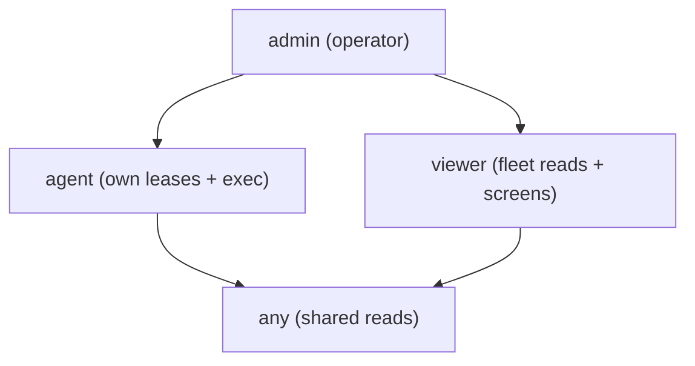

# 0090. A viewer role reads the fleet without changing it

- **Status:** Accepted; narrows [ADR 0003](0003-one-typed-daemon-contract-behind-every-frontend.md) §3 and §5, [ADR 0011](0011-the-console-is-a-built-app-the-daemon-serves.md) §6, [ADR 0033](0033-a-sign-in-proxy-is-a-second-way-to-sign-in-and-auth-is-one-module.md) §2 and §4, and [ADR 0045](0045-a-devices-screen-streams-to-operators-not-a-leases.md) §2
- **Date:** 2026-11-23
- **Supersedes:** nothing. Narrows the two-role daemon model and operator-only console/stream rules so read-only callers do not need full `operator` (`admin`) privileges.
- **Depends on:** ADR 0003 (daemon contract and roles), ADR 0011 (web console), ADR 0033 (auth module and `identity.get`), ADR 0036 (SQLite daemon state), ADR 0037 (console actions), ADR 0045 & ADR 0049 (screen streams and module lease routes).

## Context

Simlock has two session roles (`agent` and `admin`, the latter backed by `operator` tokens) and one join role (`worker`). Any person opening the web console to inspect workers, leases, events, usage, or live screens — and any monitoring script reading `/v1/workers`, `/v1/devices`, `/v1/stats`, or `/v1/events` — must hold an `operator` token. That grants full fleet mutation (`lease.release`, `worker.drain`, `worker.remove`, `worker.update`, `nuke.run`, `daemon.stop`, `token.create`, `token.revoke`, `config.get { showSecrets: true }`) and full access to every lease's `device.exec`, `/files`, `/input`, and `/tunnel`.

## Decision

### 1. Three daemon roles in a lattice

`src/contract/roles.ts` defines `ROLES = ["agent", "viewer", "admin"]` and `OperationRole = Role | "any"`. The roles form a lattice, not a chain:

- `roleAllows(session, required)` is `session === "admin" || required === "any" || session === required`. Operations keeping `role: "agent"` (lease requests, renewals, releases, `device.exec`, `device.rotate`, `driver.passthrough`, `doctor.run`) automatically refuse `viewer` with `FORBIDDEN`.
- `readsEveryLease(role)` is `role === "admin" || role === "viewer"` and governs read-side fleet visibility in both the worker and gateway dispatchers (`status.get` full view with quarantine messages, `lease.list`, `lease.get`). Write-side bypasses (`ownsLease`, `authorizeOneLeaseCall`, `lease.release-run`, `daemon.stop`) stay `role === "admin"`.
- Shared reads move to `"any"`: `identity.get`, `catalog.get`, `status.get`, `lease.list`, `lease.get`, `component.list`, `baseline.list`.
- Fleet-wide reads move to `"viewer"`: `worker.list`, `list.get`, `events.replay`, `events.subscribe`, `events.unsubscribe`, `usage.get`, `inbox.get`, `token.list`, and redacted `config.get` (`config.get { showSecrets: true }` stays `"admin"`).

### 2. Holder-or-admin lease sub-routes fail closed

HTTP resolves lease sub-routes through `findOwnedLease(deps, session, id, access)`, whose required `access` parameter is `"read"` or `"hold"`. `"hold"` checks `roleAllows(session.role, "agent")` before calling `lease.get` and refuses `viewer` with `403 FORBIDDEN`, keeping the contract operation `lease.get` free of HTTP-only flags while ensuring no caller can accidentally omit the access level:

- `GET /v1/leases/{id}` passes `"read"`.
- `GET /v1/leases/{id}/events` passes `"hold"` because subscribing drains the lease's notice buffer.
- All `/v1/leases/{id}/files*` routes pass `"hold"` so viewers cannot read or modify uploaded lease artifacts.
- Optional module lease routes (`/v1/leases/{id}/<name>`, HTTP and WebSocket) default-deny `viewer` (`route.viewerLeaseRoute === true ? "read" : "hold"`). Only `stream` opts in via `viewerLeaseRoute: true` on its module definition. `input` and `tunnel` stay holder-or-operator.
- Lease-request-by-id routes (`/v1/lease-requests/{id}`, `/events`, `DELETE`) remain owner-or-operator via `requireOwnRequest`.
- Device screen streams (`GET /v1/stream/workers/{workerId}/devices/{deviceId}`) map the HTTP role exhaustively to the contract `Role` and share `readsEveryLease`, keeping `404 UNKNOWN_DEVICE` for `agent`.

### 3. Token store migration v3 and CLI

- `TokenRole` adds `"viewer"` (`"agent" | "viewer" | "operator" | "worker"`). `Identity["role"]` adds `"viewer"`, mapped exhaustively to daemon session `"viewer"` in `src/http/dispatcher-session.ts` and `resolveHelloRole` in `src/auth/index.ts`.
- `tokensOwner` moves from version 2 to version 3 with a table-rebuild migration preserving `rowid` order, `STRICT`, `hash UNIQUE`, `worker_id`, and `tokens_worker_id`.
- `simlock token create --role viewer` creates a viewer token.

### 4. Read-only web console

- `GET /v1/workers` allows `viewer`, so viewer tokens sign in to the console.
- The console reads `role` from `/v1/identity` once per session (`LiveProvider` for token sessions, `checkIdentity` for proxy sessions), fails closed until known, gates all mutating menus and writes centrally in `useActions()` (plus filtering search palette actions in `useSearchSession`) when `role !== "admin"`, and shows `Read-only` under the signed-in name in the sidebar.

## Consequences

- `PROTOCOL_VERSION_RANGE` moves from `102` to `103` (`min` and `max`).
- `tokens` schema version 3 is a one-way database migration; an older Simlock binary refuses it unless restored from the updater's backup.
- Proxy SSO (`http.proxyAuth`) continues to assign `operator` in this change; configuring a read-only proxy role (and operator elevation UX) is deferred to a follow-up so operators behind SSO are not locked out of mutations.
