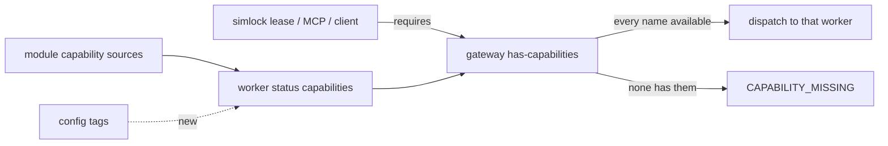

# 0091. An operator names a worker's tags, and a lease may require them

- **Status:** Accepted — not yet implemented
- **Date:** 2026-11-25
- **Feature:** #1832 (request #1541). The key's bounds, the messages and
  the stored column are in the feature's design tables.

## Context

ADR 0026 §1 made a capability an optional module a worker serves, and let
`lease.request` require one by name in `requires`. Only the modules a
build ships have names, so an operator cannot say what else sets a worker
apart. One example is a worker inside a bank's closed network, next to
another worker outside it. A lease for a test of that network can be
granted on the wrong worker, and the test then fails for a reason that
looks like an app bug.

Two more gaps stop `requires` from being used at all outside the
programmatic client. `simlock lease` has no flag for it, and the MCP lease
tool leaves it out. The contract also refuses `requires` together with
`idempotencyKey`. Its reason was that a replay would have to be checked
again against a capability state that changed since. But `simlock lease
--url` and the MCP server in farm mode send an idempotency key on every
request, so that a request sent again after a dropped connection joins the
first one.

## Decision

### 1. A worker's config names its tags

A worker's `config.json` takes a top-level `tags` list, such as
`["bank-network"]`. Each name follows the capability name pattern, is
listed once, and is not the name of a module in this build. A config that
breaks any of these is refused like any other bad value. A gateway ignores
the key with the warning it gives every worker-only key. It is read at
start, like every key.

### 2. A tag is a capability that is always available

The worker's status lists each tag in `capabilities`, after the modules,
as `available`. Nothing reads its state: the operator vouches for it. So
every reader of capabilities serves tags without a change: the gateway's
`has-capabilities` stage and its `CAPABILITY_MISSING` row, the worker's own
check on a direct request, `simlock status` and the console. `requires`
matches tags and module names alike. Users meet one word in `requires` and
`CAPABILITY_MISSING`, the one word ADR 0030 §5 gives them. `tags` is only the
name of the key the operator writes.

This narrows ADR 0026 §1, which defines a capability as "an optional module a
worker serves, by name": a capability is now also a tag the operator names.
It narrows ADR 0030 §5, where users "turn a capability on" under
`capabilities`: a tag is never turned on or off, it is listed under `tags`.

A lease that requires nothing may still land on a tagged worker. A tag
narrows where a lease that asks for it can go. It never keeps a worker for
those leases alone.

### 3. `requires` goes with an idempotency key

The refusal of `requires` with `idempotencyKey` is lifted, on a worker and
on a gateway. A replay returns the stored answer and checks nothing again,
which is the rule for every other field of a stored request. A worker
answers a replay before it checks capabilities, as a gateway already does. `requires`
becomes part of what makes a replay the same request: the same key with a
different set of names is `IDEMPOTENCY_CONFLICT`. A worker keeps the names
with the stored request, so a replay after a restart is compared too.

### 4. Every frontend can pass `requires`

`simlock lease --requires <name,...>`, the MCP `lease_simulator` tool's
`requires` and the `requires` field of `POST /v1/lease-requests` send the
list as the contract takes it.

## Consequences

- An operator steers leases by network, region or anything else they can
  name, with no new routing stage and no gateway change.
- A tag is a claim the worker makes about itself. A wrong tag sends leases
  to the wrong place, and nothing checks it.
- Tags and modules share the status list's bound of 16 entries. Today's
  five modules and at most eight tags fit. A build with more than eight
  modules must raise that bound first.
- A worker that predates this feature lists no tags, so a lease that
  requires one is never placed on it.
- Lifting the refusal is a contract change and bumps the protocol by one,
  `min` with `max`. A newer client against an older gateway is refused
  with `PROTOCOL_VERSION_UNSUPPORTED`, as after every such change.
- A later build that ships a module named like an operator's tag refuses
  that worker's config, so the worker does not start until the tag is
  renamed. The maintainer chose this over dropping the tag in silence.

## Alternatives rejected

- **Names under `capabilities.<name>`.** This is what the reporter tried.
  It would turn every unknown key under `capabilities` into a name, so a
  module typo such as `capabilities.strem` would no longer warn, and a
  later module could take a name an operator already uses.
- **Routing on the worker's display label.** `gateway.label` is a name for
  people. It is not unique, and changing it must not change where leases
  go.
- **A switch that keeps a tagged worker for leases that require its tags.**
  A CI runner can be set up this way. It was left out of scope: it would
  need a second routing filter and a refusal on the worker.
- **Dropping the idempotency key when `requires` is set.** A remote lease
  would then queue twice after a dropped connection.
- **Tags on single devices.** That is #1542, a separate request.
