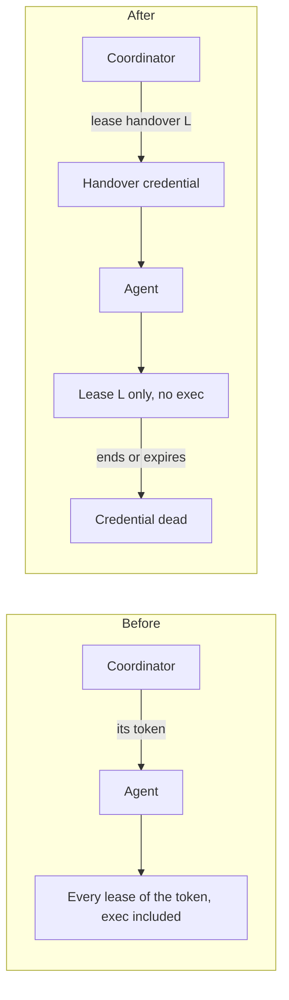

# 0092. A lease owner hands one lease to an agent with a credential that dies with it

- **Status:** Accepted — not yet implemented
- **Date:** 2026-11-27
- **Feature:** #1895 (request #1407). The credential's shape, the
  operations it may call, the messages and the stored columns are in the
  feature's design tables.
- **Narrows:** [ADR 0023](0023-agent-device-is-served-by-an-optional-edge-module.md)
  §4 ("One simlock token is one tenant"): a handover credential is a
  second credential that reaches a token's tenant, for one lease only.
  [ADR 0081](0081-a-remote-caller-speaks-the-daemon-protocol-over-one-websocket-path-with-its-tokens-identity.md)
  §2 ("The token at the upgrade is the identity"): a handover
  credential's session also ends when its lease ends.
- **Depends on:** ADR 0003, 0005, 0023, 0033, 0070, 0081.

## Context

An agent token is one principal: the token's id. Each lease made with it
is owned by that principal, and every lease route checks only that the
caller's principal is the lease's owner. So everything that holds the
token can exec on, stream, upload to, renew and release every lease of
that token. A `requesterId` per agent splits the one-lease limit, not the
access. Tokens never expire, and making or revoking one is an operator's
job.

A coordinator, such as a CI job or an agent orchestrator, leases a device
for an agent it does not fully trust. That might be an agent working on a
contributor's branch. The coordinator wants that agent to reach one
device, for as long as the lease lives, and nothing else. Today it can
only give its own token away, or ask an operator for a token per job and
remember to revoke it. Either way the agent can reach more than that one
lease, and `exec` is a shell on the worker.

## Decision

### 1. The owner makes a handover credential with its own call

A caller that owns a live lease, or an operator, asks the daemon that
granted it for a handover credential of that lease
(`simlock lease handover <lease>`, one HTTP route, one contract
operation). The answer holds an `slk_` secret, shown once, as
`token create` shows a token's. The daemon stores only its hash, beside
the tokens. A lease may be handed over more than once, and each
credential is its own. A handover credential cannot make another one.

The call comes after the grant, not as a flag on `lease.request`. A grant
is read again and again (`lease.get`, a request's event stream, a
replayed request by its idempotency key), so a secret in it would be
stored or shown more than once. A separate call works for a lease made
by any frontend, the agent-device front's included, and at any time
while the lease lives.

### 2. The credential acts as the lease's owner, on that one lease only

A handover identity carries the lease owner's principal (never an
operator's who made it) and the lease it is scoped to. Every ownership
check keeps reading the principal. Before them, two allowlists hold the
scope, so a route or operation nobody added stays refused:

- the dispatcher, on every transport (HTTP, the remote session of ADR
  0081, a gateway's dispatcher): only the listed operations, and only on
  the scoped lease; a list is cut to that lease;
- the HTTP path gate: only the lease's own paths, the lease list, and the
  identity, health, session and agent-device paths.

What the scope allows: reading and following the lease, renewing it
within `lease.maxTtlMs`, releasing it, rotating it, its screen stream and
input, its tunnels, its files, and agent-device. A tunnel reaches only the
lease's own device ports. It refuses `device.exec`, new lease requests,
another handover and every admin operation. Exec runs commands on the
worker as the daemon's user, so a credential that allowed it would not
keep an agent to one device.

Because the principal is the owner's, every ownership check and the
lease's agent-device tenant (principal and lease id) work unchanged, and
nothing of the coordinator's other leases reaches the agent.

### 3. It dies with the lease and with its owner's token

A handover credential binds to its lease's id and grant time, and
verifies only while that lease is live on the daemon that made it, so
there is no window after the lease ends, and a later lease under the same
chosen id does not revive it. A remote session opened with it is refused
at its next call after the lease ends, and closed. Streams, input and
tunnel sockets and agent-device calls on the lease already end with it.

When the owner is a token, the credential also ends when that token is
revoked or expires (ADR 0093), and carries the token's expiry.

Its stored row is deleted only once the daemon knows the lease ended. A
gateway's lease index is empty until its workers report, so a lease it
cannot see yet leaves the credential refused but kept.

### 4. agent-device opens on the handed-over lease, under two ids

Today the agent-device front makes the simlock lease at `open`, with the
lease id agent-device made up, so one id serves both. A handed-over lease
exists before `open`, and agent-device through the proxy always makes up
its own id (it ignores `--lease-id`), so the two ids differ. The front
maps them: `open` with a handover credential leases nothing, and opens
agent-device's lease on the handed-over lease's device. Toward agent-device
the front uses agent-device's id; toward simlock, and in the worker's
record of what to release when the lease ends, the handed-over lease's.
The agent needs no lease id: the credential names the lease.

One agent-device lease is open on a handed-over lease at a time. A call
that names any other lease is refused, a call that names none is held to
the handed-over lease, and nothing of the owner's is adopted under the
credential after a restart. `close` ends the simlock lease too, as it does
for a lease the front made: either side may end a handed-over lease, the
owner with `lease release` and the agent with `close` or `lease release`.

### 5. A gateway makes and checks its own

A gateway's handover credentials are the gateway's, as its tokens are
(ADR 0005). The gateway checks them, and relays calls to the worker as it
relays the owner's. A worker never sees one.

## Consequences

- A coordinator can give an untrusted agent one device without an
  operator, and without cleaning up after it.
- Every place that reads only the principal must also honour the scope:
  the two allowlists cover operations and routes, and the agent-device
  front gets its own checks, named in the feature.
- An agent with a handover credential cannot run `simctl` or `adb`
  against its device. It drives the device through agent-device, the
  stream and input, and files.
- Contract shapes change, so the protocol version moves.

## Alternatives considered

- **A flag on `lease.request` that returns the secret in the grant.**
  Rejected: the grant is re-read and replayed, so the secret would be
  stored or shown more than once, and a lease made by the agent-device
  front could not get one.
- **A new principal per credential, with the lease naming it as a
  delegate.** Rejected: every ownership check, list filter and
  agent-device tenant would have to learn a second owner.
- **A short-lived agent token per job.** It still reaches every lease made
  with it and exec, and needs an operator. ADR 0093 adds an expiry for
  the cases a lease cannot scope.
- **agent-device sends the handed-over lease's id.** Rejected: it needs
  an agent-device change, and the agent would have to pass an id the
  credential already names.
- **Exec allowed on request.** Rejected: one flag would turn the credential
  back into a worker shell, and the point of a handover is that it is not
  one.
