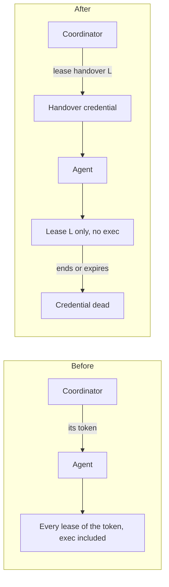

# 0092. A lease owner hands one lease to an agent with a credential that dies with it

- **Status:** Proposed
- **Date:** 2026-11-27
- **Feature:** #1895 (request #1407). The credential's shape, the
  operations it may call, the messages and the stored columns are in the
  feature's design tables.
- **Narrows:** [ADR 0023](0023-agent-device-is-served-by-an-optional-edge-module.md)
  §4 ("One simlock token is one tenant"): a handover credential is a
  second credential that reaches a token's tenant, for one lease only.
  [ADR 0081](0081-a-remote-caller-speaks-the-daemon-protocol-over-one-websocket-path-with-its-tokens-identity.md)
  §2 ("The token at the upgrade is the identity"): a handover
  credential's session also ends when its lease ends.
- **Depends on:** ADR 0003, 0005, 0023, 0033, 0070, 0081.

## Context

An agent token is one principal: the token's id. Each lease made with it
is owned by that principal, and every lease route checks only that the
caller's principal is the lease's owner. So everything that holds the
token can exec on, stream, upload to, renew and release every lease of
that token. A `requesterId` per agent splits the one-lease limit, not the
access. Tokens never expire, and making or revoking one is an operator's
job.

A coordinator, such as a CI job or an agent orchestrator, leases a device
for an agent it does not fully trust. That might be an agent working on a
contributor's branch. The coordinator wants that agent to reach one
device, for as long as the lease lives, and nothing else. Today it can
only give its own token away, or ask an operator for a token per job and
remember to revoke it. Either way the agent can reach more than that one
lease, and `exec` is a shell on the worker.

## Decision

### 1. The owner makes a handover credential with its own call

A caller that owns a live lease, or an operator, asks the daemon that
granted it for a handover credential of that lease
(`simlock lease handover <lease>`, one HTTP route, one contract
operation). The answer holds an `slk_` secret, shown once, as
`token create` shows a token's. The daemon stores only its hash, beside
the tokens. A lease may be handed over more than once, and each
credential is its own. A handover credential cannot make another one.

The call comes after the grant, not as a flag on `lease.request`. A grant
is read again and again (`lease.get`, a request's event stream, a
replayed request by its idempotency key), so a secret in it would be
stored or shown more than once. A separate call works for a lease made
by any frontend, the agent-device front's included, and at any time
while the lease lives.

### 2. The credential acts as the lease's owner, on that one lease only

A handover identity carries the owner's principal and the lease it is
scoped to. Every ownership check keeps reading the principal, and one
more check runs before them: a scoped identity may call only the
operations the feature lists, and only on its own lease. Every other
operation is `FORBIDDEN`, and so is any other lease id. The check runs
in the dispatcher, where the role check and `authorize` already run, so
the HTTP routes, the remote session (ADR 0081) and the module lease
routes that resolve a lease through `lease.get` all get it from one place.
A list is cut to the one lease.

What the scope allows: reading and following the lease, renewing it
within `lease.maxTtlMs`, releasing it, its screen stream and input, its
files, and the agent-device front. It refuses `device.exec`, new lease
requests and every admin operation. Exec runs commands on the worker as
the daemon's user, so a credential that allowed it would not keep an
agent to one device.

Because the principal is the owner's, the agent and the coordinator share
the lease's agent-device tenant (principal and lease id). The coordinator
can watch what the agent does on its own lease, and nothing of the
coordinator's other leases reaches the agent.

### 3. It dies with the lease

A handover credential verifies only while its lease is live on the
daemon that made it. A verify that finds the lease gone refuses it, so
there is no window after a lease ends. Its stored row is deleted when the
lease ends, and at daemon start for every lease that is no longer live.
A remote session opened with it closes when the lease ends, as
`token revoke` closes a token's. Streams, input sockets and agent-device
calls on the lease already end with it.

### 4. agent-device attaches to the handed-over lease

`agent-device open --lease-id <lease>` with a handover credential does
not lease a new device. agent-device already lets the caller name its
lease id, and the front already uses one id for the agent-device lease
and the simlock lease. So the front reads the credential's lease instead
of requesting one, and forwards the allocate on the device that lease
holds, as it already does when it allocates again after agent-device
forgot a lease. An open with any other lease id is refused, with a
message that names the handed-over lease. A call that names another lease is refused, and
a call that names none is held to the credential's lease. `close`
releases the agent-device lease and leaves the simlock lease to its
owner.

### 5. A gateway makes and checks its own

A gateway's handover credentials are the gateway's, as its tokens are
(ADR 0005). The gateway checks them, and relays calls to the worker as it
relays the owner's. A worker never sees one.

## Consequences

- A coordinator can give an untrusted agent one device without an
  operator, and without cleaning up after it.
- Every place that reads only the principal (the `lease.list` filter, the
  agent-device `devices` cut, the front's map) must also honour the scope.
  The dispatcher check covers the operations; the agent-device front gets
  its own, named in the feature.
- An agent with a handover credential cannot run `simctl` or `adb`
  against its device. It drives the device through agent-device, the
  stream and input, and files.
- Contract shapes change, so the protocol version moves.

## Alternatives considered

- **A flag on `lease.request` that returns the secret in the grant.**
  Rejected: the grant is re-read and replayed, so the secret would be
  stored or shown more than once, and a lease made by the agent-device
  front could not get one.
- **A new principal per credential, with the lease naming it as a
  delegate.** Rejected: every ownership check would learn a second owner,
  and the agent would get its own agent-device tenant, so the coordinator
  could not see the agent's sessions.
- **A short-lived agent token per job.** It still reaches every lease made
  with it and exec, and needs an operator. ADR 0093 adds an expiry for
  the cases a lease cannot scope.
- **Exec allowed on request.** Rejected: one flag would turn the credential
  back into a worker shell, and the point of a handover is that it is not
  one.
