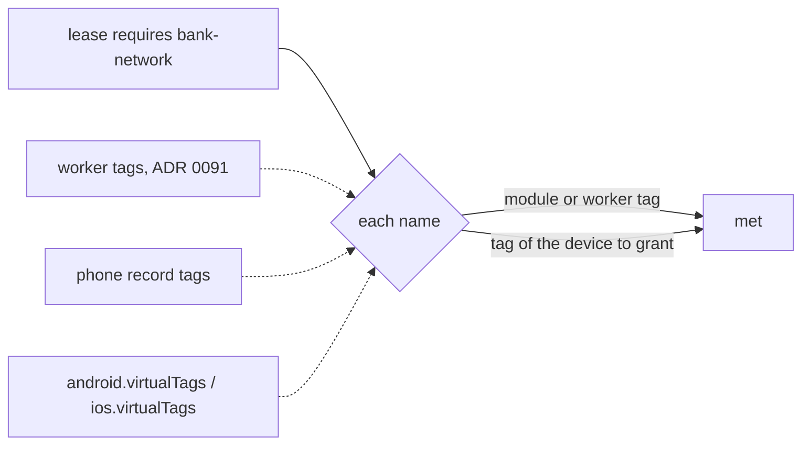

# 0092. An enrolled device and a platform's virtual devices carry tags a lease may require

- **Status:** Accepted — not yet implemented
- **Date:** 2026-11-27
- **Feature:** #1894 (request #1542). The names' bounds, the messages, the
  stored column and the operation's shape are in the feature's design
  tables.

## Context

ADR 0091 lets an operator name a worker's tags, and a lease's `requires`
matches them. A worker tag says something about every device the worker
serves. One machine can hold two kinds of device that differ in what the
tag says. In the request behind this ADR, one Mac runs Android emulators
that reach a bank's closed network, and real phones enrolled on the same
Mac that cannot. A worker tag `bank-network` would send a closed-network
test to a phone as readily as to an emulator. `--physical` splits the two
kinds today only by chance: it stops matching the day a phone joins the
closed network.

An enrolled phone is a stored record, so a tag can sit on it. A virtual
device has no record before a lease: the worker makes it from the catalog
when a request needs it, or ahead of time for the warm pool. A tag for
virtual devices has to sit on what decides which devices the worker makes.

## Decision

### 1. An enrolled device carries the tags an operator gives it

An enrolled physical device keeps a list of tags on its record. The
operator sets them at enrolment (`simlock device add --tags`) and replaces
them at any time (`simlock device tag`), with no restart and whether the
device is present, free or leased. A change applies from the next grant: a
lease already held keeps its device. A device the auto-enroller writes
starts with no tags, and a re-enrolment keeps the tags the record had.

### 2. A platform's virtual devices carry the tags its config names

`android.virtualTags` and `ios.virtualTags` name tags that every
simulator or emulator of that platform on the worker carries. They are
read at start, like every key. Every virtual device of one platform has
the same tags, so the warm pool, its learned kinds and baselines key on
nothing new.

### 3. `requires` is met by the worker or by the device it grants

A name in `requires` is met when the worker serves it (a module, or a
worker tag, as ADR 0026 §1 and ADR 0091 §2 say), or when the device to be
granted carries it as a tag of its own. So a worker tag reads as "every
device here has it". A request is granted only a device for which every
name is met. When a device fits the request's model, OS and class but no
fitting device meets every name, the answer is `CAPABILITY_MISSING`, on a
worker and through a gateway, as for a worker tag. A request that waits
for a device keeps waiting only for a device that meets every name.

The gateway reads a worker's device tags and virtual tags from the view
it already keeps. It routes with the stages it has: the capability check
and the device match each take the device's own tags into account. No
stage is added.

Device tags follow the rules of worker tags (ADR 0091 §1): the capability
name pattern, each listed once, none the name of a module. They never
enter the status list of capabilities, so ADR 0091's bound of 16 entries
is not touched.

A lease that requires nothing may still be granted a tagged device, as
ADR 0091 §2 says for a tagged worker.

## Consequences

- One worker serves two populations, and a lease picks one by naming a
  tag. `--physical` goes back to meaning only "a real device".
- A tag on a phone is a claim the operator makes. A wrong tag sends leases
  to the wrong device, and nothing checks it.
- Device tags are wire shapes: the device in a status answer, a
  platform's catalog entry, `device.add` and a new operation that sets a
  device's tags. The protocol is bumped by one, `min` with `max`.
- The physical device record gains one stored column.
- A worker from before this ADR shows no device tags, so a lease that
  requires one is never placed on it, as for worker tags.

## Alternatives rejected

- **A second lease field for device tags.** Users would have to know
  whether a name lives on the worker or on the device. Every frontend
  would grow a second flag.
- **Tags on warm-pool targets.** A lease makes devices outside the
  targets, and those would carry no tags. The warm pool, its learned kinds
  and the gateway's warm hits would all have to key on tags.
- **One list for every virtual device of the worker.** It cannot tag
  Android emulators without tagging iOS simulators too.
- **Tags only at `device add`.** Changing a tag would need the phone
  plugged in and free, since a re-enrolment reads the device again.
- **Keeping a tagged device for leases that require its tags.** Left out
  for the reason ADR 0091 left it out for workers.
