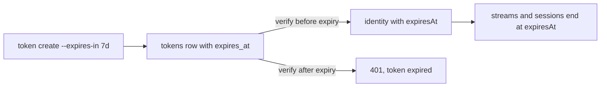

# 0093. An agent or operator token may carry an expiry

- **Status:** Accepted — not yet implemented
- **Date:** 2026-11-27
- **Feature:** #1895 (request #1407). The flag, the stored column and the
  messages are in the feature's design tables.
- **Narrows:** [ADR 0081](0081-a-remote-caller-speaks-the-daemon-protocol-over-one-websocket-path-with-its-tokens-identity.md)
  §2: "A session opened by an identity with an expiry (a proxy JWT)" now
  includes a token with an expiry.
- **Depends on:** ADR 0003, 0005, 0033, 0081.

## Context

A token lives until `token revoke`. An operator who makes a token for a
day's work, a contractor or one CI pipeline has to remember to revoke it,
and a forgotten one keeps its rights for good. ADR 0092 covers the case
where the work is one lease; many are not (a job that takes several
leases, an operator's console sign-in for a week).

A proxy sign-in already has an expiry (ADR 0033): the identity carries
`expiresAt`, a stream opened with it ends then (§6), and so does a remote
session (ADR 0081 §2). A token has none, so those paths never fire for
one.

## Decision

### 1. `token create` takes an optional lifetime

`simlock token create --expires-in <duration>` (and the operation's
input) sets when the token stops working, read by the one duration
parser. Without it a token never expires, as today. Only `agent` and
`operator` tokens take one: a worker's join token pins a worker, and an
expiry would cut a fleet's uplink with no one watching.

### 2. An expired token is refused, and the identity carries the expiry

Verify refuses a token past its expiry with its own message, so the
holder can tell an expired token from a wrong one. A token that is not
expired gives an identity with `expiresAt` set, so every path that ends
a proxy identity's work at its expiry ends a token's too, with no new
code there. `token list` shows the expiry, and an expired token stays
listed until it is revoked, so an operator sees what ran out.

## Consequences

- An operator can make a token that cleans itself up.
- Existing tokens and every client that does not pass a lifetime work as
  today. The token store gains one column; the contract gains one field,
  so the protocol version moves.

## Alternatives considered

- **Expired rows deleted at once.** Rejected: the operator would lose the
  record of who had a token and when it ran out, and the holder would get
  "unknown token" instead of "expired".
- **A default lifetime for new tokens.** Rejected: it would break every
  setup that makes a token once, such as the local agent-device profile
  (ADR 0046).
