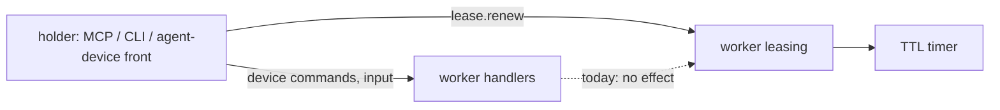
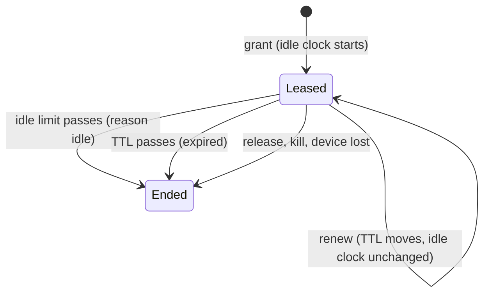

# 0094. A worker ends a lease whose device goes unused

- **Status:** Proposed
- **Date:** 2026-11-27
- **Feature:** #1899 (request #1553). The key, its default and bounds,
  what counts as use, the end reason, the messages and the record fields
  are in the feature's design tables.

## Context

ADR 0004 §1 made a client-initiated `lease.renew` the only thing that
keeps a lease alive. A renew says the holder's process is alive. It says
nothing about whether the holder still uses the device. The MCP server
renews for as long as the agent's session is open, and a held
`simlock lease` renews for as long as it runs. An agent that finished its
work and waits for a person, or forgot to release, keeps a booted
simulator for hours. On a shared worker that device is capacity another
agent is queued for.

The worker already sees every call that acts on a leased device: a
command (`device.exec`, the passthrough's resolution, `device.rotate`),
input on the lease's input socket, and every agent-device command, local
or relayed from a gateway, passes through the worker that owns the lease.

## Decision

1. **A lease has a second clock, the idle clock, beside its TTL.** The
   worker ends a lease when no use has reached it for the worker's idle
   limit, whatever its renews. The TTL still ends a lease whose holder
   stopped renewing. Either clock alone ends it. This narrows ADR 0004 §1:
   a renew keeps a lease alive only while its device is used.
2. **Use is a call that acts on the device.** Commands, input and
   agent-device commands count; a command counts for as long as it runs.
   Renewals, status and list reads, watching the screen stream, tunnel
   traffic and lease files do not. Nothing counts as use without acting on
   the device: there is no call that only resets the idle clock, so a
   renew loop cannot become one.
3. **The operator sets the limit on the worker, and it is on by default.**
   A lease request cannot change it. `0` turns it off. A gateway holds no
   idle clock: it forwards use to the owning worker as it does today, and
   a lease ends only on the worker's fact (ADR 0005, gateway leases).
4. **An idle ending is a lease end like any other.** It goes through the
   one release path with its own reason, `idle`, so events, the history,
   the holder's lease-lost notice and the reclaim follow without a new
   path. The lease record shows when the device was last used and when
   the idle clock will end it.
5. **The idle clock lives in memory.** A daemon start begins every
   restored lease's idle clock again from the start; nothing about use is
   stored.

## Consequences

- A forgotten lease frees its device at most one idle limit after its
  last use, even while its holder renews.
- A tool that drives the device without simlock (`xcrun simctl`, `adb`,
  Detox, Maestro run directly) is not seen. Its lease ends at the limit
  while it works. The operator raises the limit or sets `0` for such a
  worker. Because the limit is on by default, the website's leases page
  says so.
- A long test run started through simlock is safe: it counts until it
  ends. A person who only watches the screen is not.
- A daemon restart gives every lease a full idle limit again.
- This is the base for suspending an idle lease instead of ending it
  (#1554): the same clock, another action.

## Alternatives considered

- **Off by default.** Changes nothing for anyone, but the forgotten lease
  is the common case on a worker shared by agents, and few operators
  would find the key. Rejected by the maintainer.
- **A request may set its own idle limit.** Adds a field to
  `lease.request`, a flag and an MCP field, and lets an agent opt out of
  the operator's policy. Rejected: the operator owns capacity.
- **Watch the device itself** (screen changes, Android's last user
  activity, host processes naming the device). Sees tools simlock does
  not, but costs a screenshot or a probe per device per minute, and
  differs per platform. Rejected for now; it can add use signals later
  without changing this decision.
- **A keep-alive call.** Any holder would call it on a timer, and the
  lease would be back to "alive while the process is". Rejected.
- **Warn the holder before the end.** The usual idle holder is an agent
  between turns, which cannot act on a warning. The idle deadline on the
  lease record serves a script or a person who watches.
- **Count tunnel traffic or open streams.** Metro's long-lived socket and
  a console tab left open would keep a lease alive forever. Rejected.
