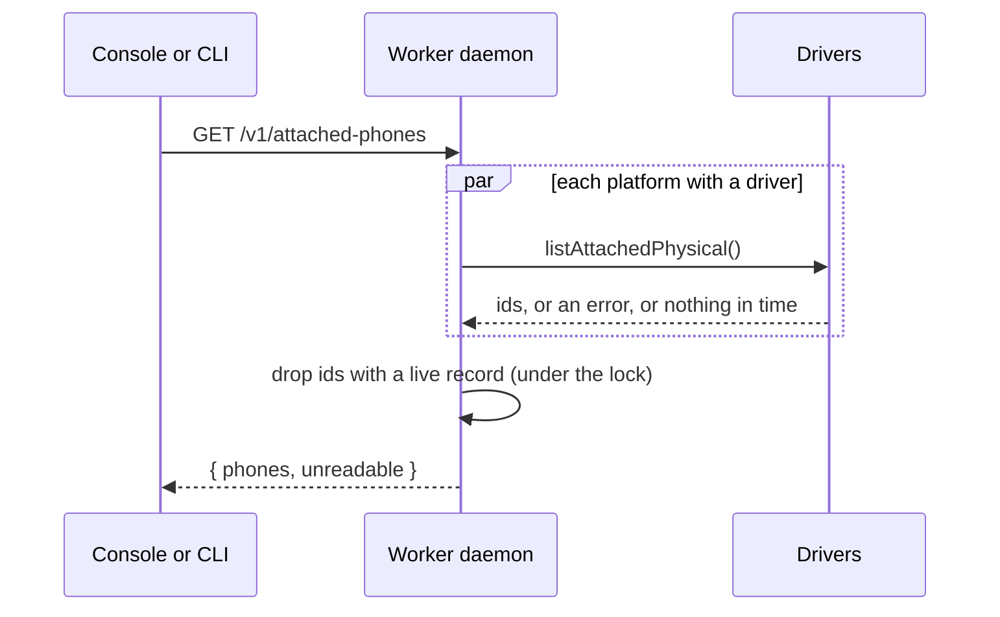
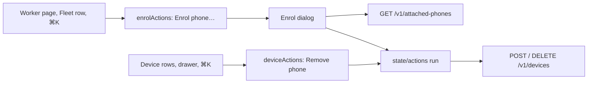

# 0095. The console offers phone actions on a worker, and a worker lists the phones it could enrol

- **Status:** Accepted — not yet implemented
- **Date:** 2026-11-27
- **Feature:** #1131 (request #1130). The operation's shape, the
  messages, the limits and the console's words are in the feature's
  design tables.
- **Depends on:** ADR 0022 (a physical device is a second device type),
  ADR 0037 (the console acts through the HTTP routes), ADR 0050
  (`device remove` is for phones only), ADR 0061 (every virtual device is
  a copy), ADR 0073 (auto-enroll), ADR 0080 (network phones). Extends
  0037 §3's action lists with one for devices and one more for a worker.

## Context

#1130 asks the console to manage a worker's devices. To enrol a phone
today, an operator opens a terminal, finds its id with `xcrun devicectl
list devices` or `adb devices -l`, and runs `simlock device add`. To
unenrol one, `simlock device remove`. `POST /v1/devices` and
`DELETE /v1/devices/{id}` exist, answer on a worker, and a gateway refuses
both by design: they act on a phone plugged into one machine.

The console has no device actions. Its worker actions (drain, undrain,
remove, update) are offered only on a gateway, since a single host
answers their routes with 501.

The worker already knows which phones are plugged in: each driver lists
them (`listAttachedPhysical`), and auto-enroll reads that list. No route
gives it to a caller. `GET /v1/devices` lists the records Simlock holds,
which is a different thing.

#1130 also asks to delete an idle simulator or emulator. Under ADR 0061
every virtual device serves one lease and is destroyed after it, so an
idle one is either kept by the warm pool, which boots a new one a minute
after a delete, or about to be deleted by the idle rules.

## Decision

### 1. A worker lists the phones plugged into it that have no record

A new admin read, `device.attached` (`GET /v1/attached-phones`, `simlock
device attached`), answers each phone a driver lists with no live record
by its platform and id, and each platform it could not read with the
reason. It is its own operation and route, not a filter of
`GET /v1/devices`: that route answers Simlock's own records, and a phone
with no record is not one.

A phone is left out when a live record holds its id or its hardware
serial. One case gets through: a phone enrolled by USB serial and also
connected over Wi-Fi is listed by its address, since only an inspection
reads which phone an address is. `device add` then refuses it as enrolled
under another id, and the console shows that refusal. A removed phone that is still plugged in is
listed: auto-enroll keeps it out (ADR 0073 §3), but the operator may
enrol it again.

Each platform's list is bounded, and a slow or failed one is reported,
not raised, so one platform never hides the other's phones.

A gateway refuses it, as it refuses `device.add` and `device.remove`.
The answer is a new shape, so the protocol rises.

### 2. The console offers phone actions on a worker only

`ui/src/model/actions.ts` gains a device action list, read by the worker
page's device rows, the device drawer and ⌘K:

| Action       | Route                     | Offered when                                                   | Before it runs             |
| ------------ | ------------------------- | -------------------------------------------------------------- | -------------------------- |
| Remove phone | `DELETE /v1/devices/{id}` | worker mode, a physical device `ready`, `absent` or `quarantined` | a confirm naming the phone |

A worker gains **Enrol phone…** in worker mode, on its page, its Fleet
row and ⌘K. It opens a dialog that reads §1's list while open and offers
each phone, and a typed platform and id for any phone the list misses,
such as a network phone not yet connected. It sends `POST /v1/devices`.
The console checks only that a typed id is not empty: the daemon's rule
stays in one place, and its refusal shows in the error toast.

These are the first actions offered in worker mode rather than gateway
mode. The console reads the mode as ADR 0037 §4 says, and offers none of
them when it is `gateway` or unknown.

### 3. `device remove` stays for phones

Neither the console nor `device remove` deletes a simulator or emulator.
ADR 0050's rejection of a virtual delete on `device remove` stands. What
the warm pool keeps is changed through the pool's own controls.

## Consequences

- An operator enrols and removes phones from a worker's console, without
  looking an id up, and can list them from the CLI and HTTP API.
- A worker answers one more admin read; it runs the same driver list
  auto-enroll runs, at most once a few seconds while a dialog is open.
- A console on a gateway still sends the operator to the worker's own
  console or CLI for phones.
- An older worker answers the console's list with 404; the dialog shows
  the daemon's message and still takes a typed id.

## Alternatives considered

- **A typed id only, no list.** Rejected by the maintainer: it keeps the
  trip to a terminal for every phone when auto-enroll is off.
- **List attached phones in `GET /v1/devices`.** Rejected: that route
  answers Simlock's records; mixing in phones with none would make every
  reader tell the two apart.
- **Delete an idle simulator or emulator with `device remove`** (the
  first draft of this feature). Rejected: under ADR 0061 an idle device
  is either remade by the pool within a minute or deleted by the idle
  rules within the hour, so the action rarely does what the operator
  wants; lowering what the pool keeps does.
- **Read each phone's model and OS for the list.** Rejected: that is the
  enrolment's inspection, several reads of up to 30 s each per phone;
  the model shows once the phone is enrolled.
- **Relay phone actions through a gateway.** Deferred, with the other
  fleet-wide commands in `docs/internal/IDEAS.md`.
